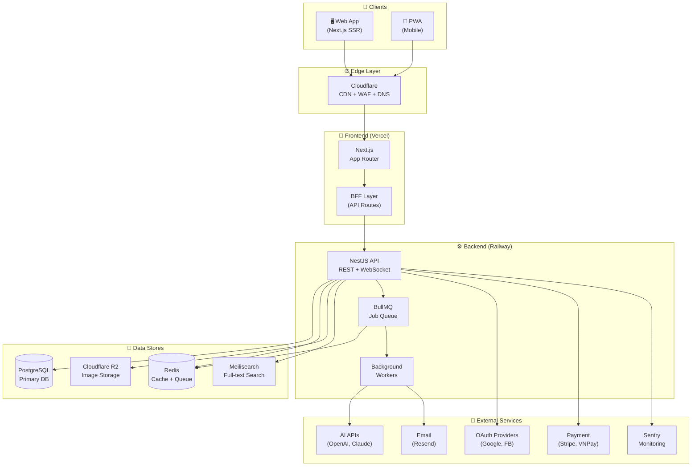
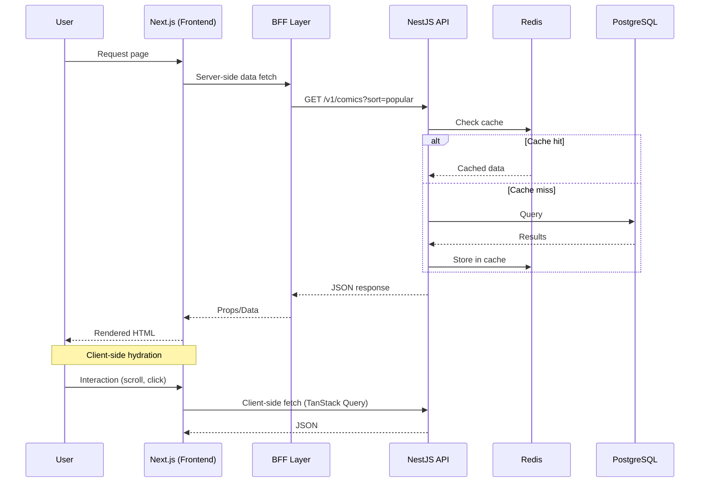
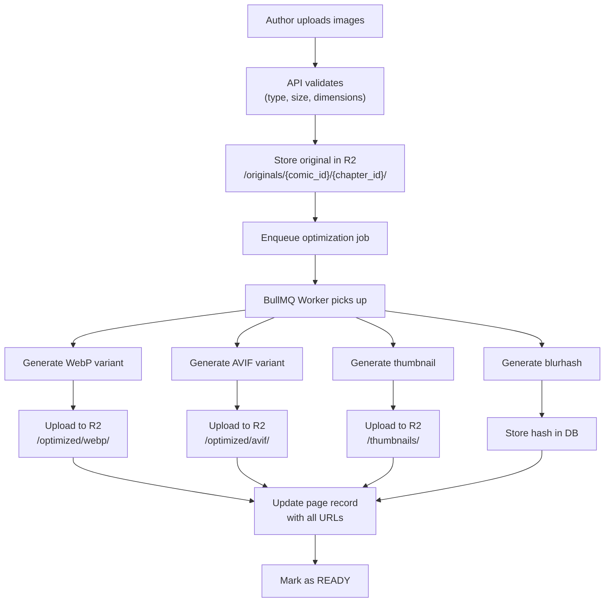
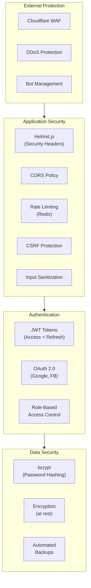
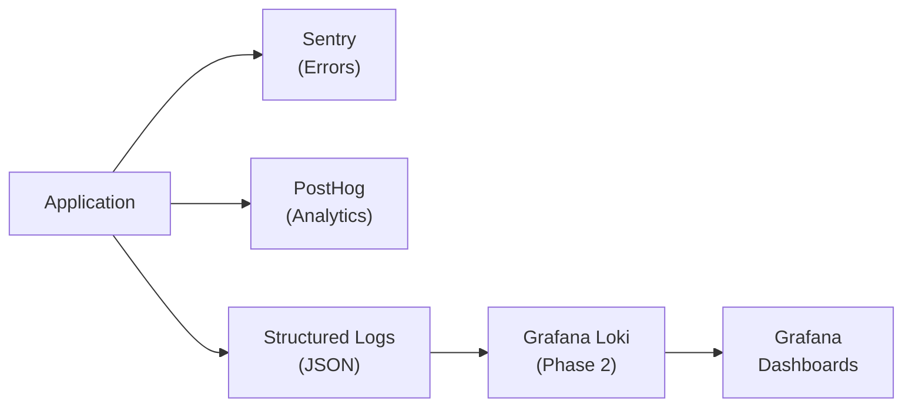
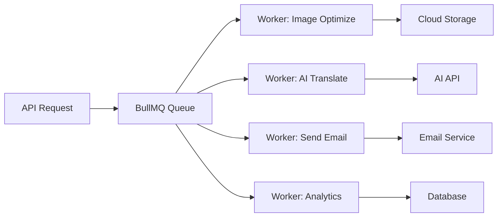

# 🏗️ Architecture – Comic Reading Platform

> **Phiên bản**: 1.0  
> **Pattern**: Modular Monolith (MVP) → Microservices (Scale)  
> **Cập nhật**: 2026-02-10

---

## 1. Tổng quan Kiến trúc

### 1.1. Triết lý

> **"Start simple, scale when needed"**

- **Phase 1 (MVP)**: Modular Monolith — toàn bộ backend trong 1 app NestJS, chia module rõ ràng
- **Phase 2-3 (Growth/Scale)**: Tách dần các module thành microservices khi cần

### 1.2. High-Level Architecture



---

## 2. Frontend Architecture

### 2.1. Next.js App Router Structure

```
┌──────────────────────────────────────────────────────────┐
│                    NEXT.JS APP ROUTER                     │
├──────────────────────────────────────────────────────────┤
│                                                           │
│  ┌────────────────┐  ┌────────────────┐                  │
│  │  Server        │  │  Client        │                  │
│  │  Components    │  │  Components    │                  │
│  │                │  │                │                  │
│  │  • Pages       │  │  • Interactive │                  │
│  │  • Layouts     │  │  • Reader      │                  │
│  │  • Data fetch  │  │  • Comments    │                  │
│  │  • SEO         │  │  • Forms       │                  │
│  └────────────────┘  └────────────────┘                  │
│           │                    │                          │
│           ▼                    ▼                          │
│  ┌────────────────────────────────────────┐              │
│  │          State Management              │              │
│  │  ┌──────────┐  ┌───────────────────┐  │              │
│  │  │ Zustand   │  │ TanStack Query    │  │              │
│  │  │           │  │                   │  │              │
│  │  │ • UI state│  │ • Server state    │  │              │
│  │  │ • Theme   │  │ • Caching         │  │              │
│  │  │ • Reader  │  │ • Refetching      │  │              │
│  │  │   settings│  │ • Optimistic      │  │              │
│  │  └──────────┘  └───────────────────┘  │              │
│  └────────────────────────────────────────┘              │
│                       │                                   │
│  ┌────────────────────▼───────────────────┐              │
│  │           BFF (API Routes)              │              │
│  │  • Token management                    │              │
│  │  • Request aggregation                 │              │
│  │  • Image optimization proxy            │              │
│  └────────────────────────────────────────┘              │
└──────────────────────────────────────────────────────────┘
```

### 2.2. Rendering Strategy

| Trang | Rendering | Lý do |
|-------|-----------|-------|
| Homepage | SSR + ISR (60s) | SEO + Fresh content |
| Comic detail | SSR + ISR (300s) | SEO + Cacheable |
| Chapter list | SSR | SEO |
| Reading page | CSR | Interactive, no SEO needed |
| User profile | CSR | Private |
| Search results | SSR | SEO |
| Author dashboard | CSR | Private, dynamic |
| Admin panel | CSR | Private |

### 2.3. Data Flow



---

## 3. Backend Architecture

### 3.1. NestJS Module Structure

```
┌──────────────────────────────────────────────────────────┐
│                     NESTJS APPLICATION                     │
├──────────────────────────────────────────────────────────┤
│                                                           │
│  ┌─────────────────────────────────────────────────┐     │
│  │              CORE MODULES                         │     │
│  │  ┌──────┐ ┌──────┐ ┌──────┐ ┌──────┐ ┌──────┐  │     │
│  │  │Auth  │ │User  │ │Comic │ │Chapter│ │Media │  │     │
│  │  │Module│ │Module│ │Module│ │Module │ │Module│  │     │
│  │  └──────┘ └──────┘ └──────┘ └──────┘ └──────┘  │     │
│  └─────────────────────────────────────────────────┘     │
│                                                           │
│  ┌─────────────────────────────────────────────────┐     │
│  │           FEATURE MODULES                         │     │
│  │  ┌──────┐ ┌──────┐ ┌──────┐ ┌──────┐ ┌──────┐  │     │
│  │  │Search│ │Notify│ │Rating│ │Comment│ │Report│  │     │
│  │  │Module│ │Module│ │Module│ │Module │ │Module│  │     │
│  │  └──────┘ └──────┘ └──────┘ └──────┘ └──────┘  │     │
│  └─────────────────────────────────────────────────┘     │
│                                                           │
│  ┌─────────────────────────────────────────────────┐     │
│  │           SHARED MODULES                          │     │
│  │  ┌──────┐ ┌──────┐ ┌──────┐ ┌──────┐ ┌──────┐  │     │
│  │  │Prisma│ │Redis │ │Queue │ │Logger│ │Config│  │     │
│  │  │Module│ │Module│ │Module│ │Module│ │Module│  │     │
│  │  └──────┘ └──────┘ └──────┘ └──────┘ └──────┘  │     │
│  └─────────────────────────────────────────────────┘     │
│                                                           │
└──────────────────────────────────────────────────────────┘
```

### 3.2. Module Detail

Mỗi module trong NestJS tuân theo cấu trúc:

```
module-name/
├── module-name.module.ts        # Module definition
├── module-name.controller.ts    # HTTP handlers
├── module-name.service.ts       # Business logic
├── module-name.repository.ts    # Data access (Prisma)
├── dto/                          # Data Transfer Objects
│   ├── create-*.dto.ts
│   ├── update-*.dto.ts
│   └── response-*.dto.ts
├── entities/                     # Domain entities
├── guards/                       # Auth guards (if specific)
├── interceptors/                 # Custom interceptors
└── __tests__/                    # Unit tests
```

### 3.3. Request Processing Pipeline

```mermaid
graph LR
    A["HTTP Request"] --> B["Middleware<br/>(Helmet, CORS, Logger)"]
    B --> C["Guards<br/>(Auth, Roles)"]
    C --> D["Interceptors<br/>(Transform, Cache)"]
    D --> E["Pipes<br/>(Validation, Transform)"]
    E --> F["Controller<br/>(Route Handler)"]
    F --> G["Service<br/>(Business Logic)"]
    G --> H["Repository<br/>(Data Access)"]
    H --> I["Database /<br/>Cache"]
    
    I --> J["Response<br/>Transform"]
    J --> K["HTTP Response"]
```



---

## 4. Image Processing Pipeline

### 4.1. Upload Flow



### 4.2. Delivery Flow

```
User requests image
     │
     ▼
Cloudflare CDN (Edge cache)
     │
     ├── Cache HIT ──→ Serve from edge (< 50ms)
     │
     └── Cache MISS
          │
          ▼
     Cloudflare R2 (Origin)
          │
          ▼
     Serve image + cache at edge
     │
     ▼
Client receives image
     │
     ├── <picture> tag selects best format
     │   ├── AVIF (if supported, ~30% smaller)
     │   ├── WebP (fallback, ~25% smaller)
     │   └── JPEG (final fallback)
     │
     └── Lazy loading + blurhash placeholder
```

---

## 5. Caching Architecture

### 5.1. Multi-Level Cache

```
┌──────────────────────────────────────────┐
│            CACHING LAYERS                 │
│                                           │
│  L1: Browser Cache                        │
│  ├── Static assets: 1 year (immutable)    │
│  ├── API responses: no-cache              │
│  └── Images: 30 days                      │
│                                           │
│  L2: CDN Cache (Cloudflare)               │
│  ├── Static pages (ISR): 60-300s          │
│  ├── Images: 30 days                      │
│  └── API: respect Cache-Control           │
│                                           │
│  L3: Application Cache (Redis)            │
│  ├── Hot data: 5-15 min                   │
│  ├── Aggregations: 10-60 min              │
│  └── Sessions: 24h                        │
│                                           │
│  L4: Database (PostgreSQL)                │
│  └── Source of truth                      │
│                                           │
└──────────────────────────────────────────┘
```

### 5.2. Cache Invalidation Strategy

| Event | Invalidate |
|-------|-----------|
| Truyện mới publish | `homepage:*`, `genre:{slug}:*` |
| Chapter mới | `comic:{id}:*`, bookmark users' feeds |
| User update profile | `user:{id}:profile` |
| Comment mới | `chapter:{id}:comments` |
| Rating mới | `comic:{id}`, `homepage:top_rated` |

---

## 6. Security Architecture



---

## 7. Scalability Plan

### 7.1. Phase 1: Single Server (0-10K users)

```
┌──────────────────────┐
│   Vercel (Frontend)   │
└──────────┬───────────┘
           │
┌──────────▼───────────┐
│  Railway (Backend)    │
│  ┌─────────────────┐ │
│  │ NestJS + BullMQ  │ │
│  └─────────────────┘ │
│  ┌──────┐ ┌───────┐  │
│  │ PG   │ │ Redis │  │
│  └──────┘ └───────┘  │
└──────────────────────┘
```

### 7.2. Phase 2: Horizontal Scaling (10K-100K users)

```
┌──────────────────────┐
│   Vercel (Frontend)   │
│   (auto-scaled)       │
└──────────┬───────────┘
           │
    ┌──────▼──────┐
    │ Load Balancer│
    └──────┬──────┘
     ┌─────┼─────┐
     ▼     ▼     ▼
  ┌────┐┌────┐┌────┐
  │API ││API ││API │   ← Horizontal scaling
  │ #1 ││ #2 ││ #3 │
  └────┘└────┘└────┘
     │     │     │
  ┌──▼─────▼─────▼──┐
  │  Managed PG     │   ← Read replicas
  │  (Primary +     │
  │   2 Replicas)   │
  └─────────────────┘
  
  ┌─────────────────┐
  │  Redis Cluster   │
  └─────────────────┘
```

### 7.3. Phase 3: Service-Oriented (100K+ users)

```
┌──────────────────────────────────────────────┐
│                API Gateway                    │
└──────────────────┬───────────────────────────┘
    ┌──────────────┼──────────────┐
    ▼              ▼              ▼
┌────────┐  ┌──────────┐  ┌──────────┐
│ Comic   │  │ Auth     │  │ Media    │
│ Service │  │ Service  │  │ Service  │
└────────┘  └──────────┘  └──────────┘
    ▼              ▼              ▼
┌────────┐  ┌──────────┐  ┌──────────┐
│ Comic  │  │ User     │  │ R2       │
│ DB     │  │ DB       │  │ Storage  │
└────────┘  └──────────┘  └──────────┘
```

---

## 8. Error Handling & Logging

### 8.1. Error Handling Strategy

```
┌─────────────────────────────┐
│      Error Categories        │
├─────────────────────────────┤
│                              │
│  Operational Errors          │
│  ├── Validation failures     │ → 400, log info
│  ├── Auth failures           │ → 401/403, log warn
│  ├── Not found               │ → 404, no log
│  ├── Rate limiting           │ → 429, log warn
│  └── External service fails  │ → 503, log error + retry
│                              │
│  Programmer Errors           │
│  ├── Unhandled exceptions    │ → 500, log error + Sentry
│  ├── Type errors             │ → 500, log error + Sentry
│  └── Memory leaks            │ → Monitor + alert
│                              │
└─────────────────────────────┘
```

### 8.2. Logging Levels

| Level | Khi nào | Ví dụ |
|-------|---------|-------|
| `error` | Lỗi cần xử lý ngay | DB connection lost, unhandled exception |
| `warn` | Vấn đề tiềm ẩn | Rate limit approached, slow query |
| `info` | Business events | User registered, comic published |
| `debug` | Development details | Query executed, cache hit/miss |

### 8.3. Observability Stack



---

## 9. Communication Patterns

### 9.1. Synchronous (Request-Response)

Sử dụng cho:
- Đọc dữ liệu (GET requests)
- Tạo/cập nhật cần phản hồi ngay (POST/PUT)
- Auth flows

### 9.2. Asynchronous (Event-Driven)

Sử dụng cho:
- Image optimization (sau upload)
- AI translation (background processing)
- Email notifications
- Analytics aggregation



### 9.3. Real-time (WebSocket)

Sử dụng cho:
- Live comments khi đang đọc truyện
- Notifications
- Reading presence (ai đang đọc cùng chapter)
