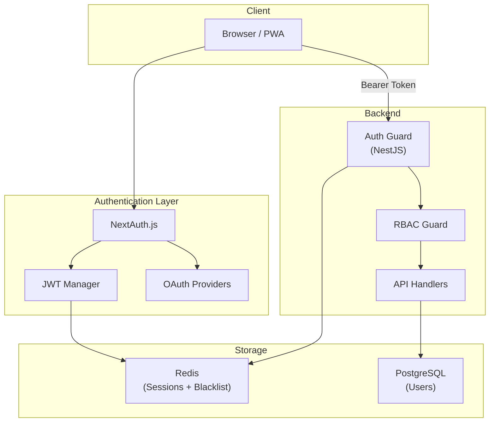
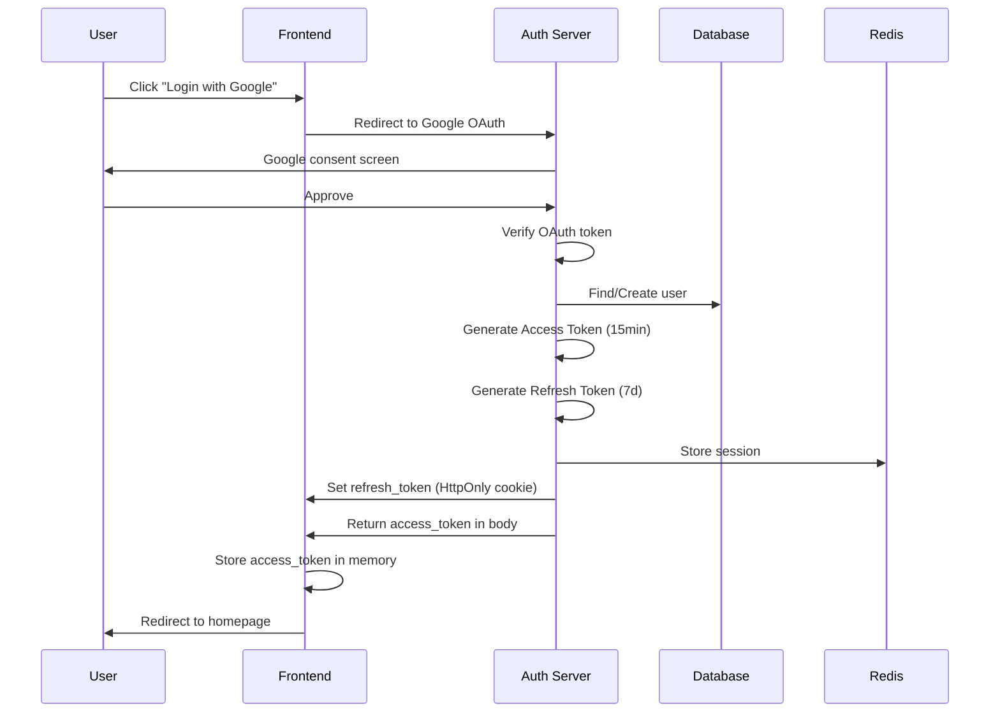
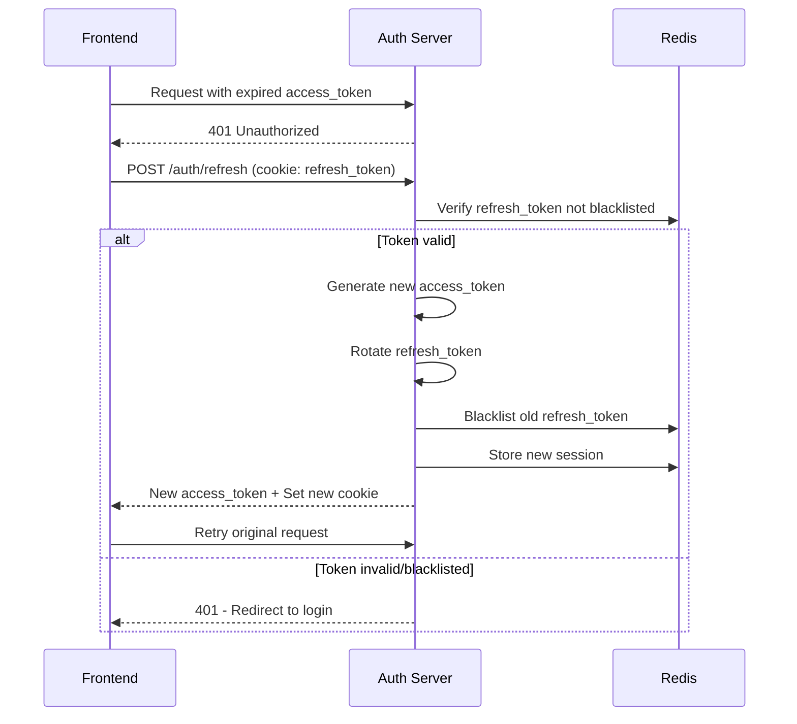
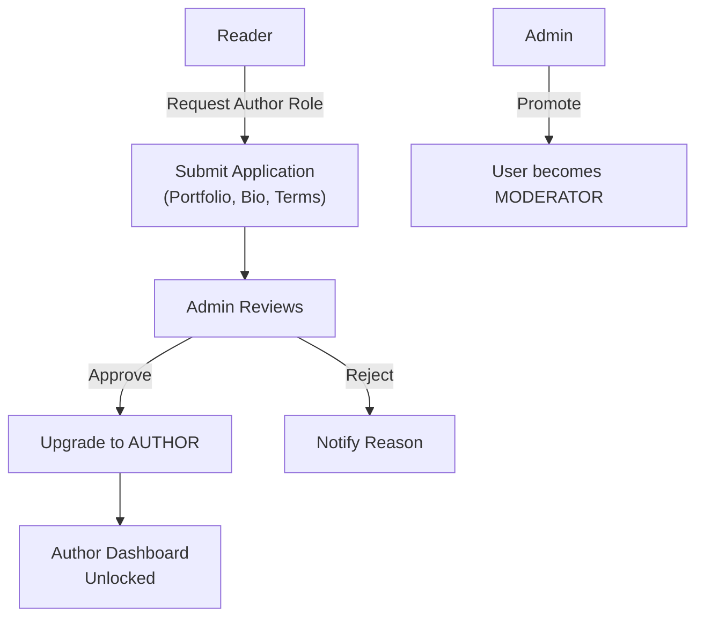

# 🔐 Authentication & Authorization – Comic Reading Platform

> **Phiên bản**: 1.0  
> **Stack**: NextAuth.js (Auth.js) + JWT + Redis  
> **Cập nhật**: 2026-02-10

---

## 1. Tổng quan

### 1.1. Authentication vs Authorization

| Aspect | Authentication (AuthN) | Authorization (AuthZ) |
|--------|----------------------|---------------------|
| **Câu hỏi** | "Bạn là ai?" | "Bạn được phép làm gì?" |
| **Cơ chế** | JWT + OAuth | RBAC (Role-Based Access Control) |
| **Thời điểm** | Khi login | Mỗi request |

### 1.2. Kiến trúc tổng quan



---

## 2. Authentication

### 2.1. Phương thức đăng nhập

| Phương thức | Provider | Ưu tiên |
|------------|----------|---------|
| **Google OAuth** | Google | ⭐⭐⭐⭐⭐ (Primary) |
| **Facebook OAuth** | Facebook | ⭐⭐⭐⭐ |
| **GitHub OAuth** | GitHub | ⭐⭐⭐ (cho tác giả/dev) |
| **Email/Password** | Local | ⭐⭐⭐⭐ (Fallback) |

### 2.2. JWT Token Strategy

```
┌─────────────────────────────────────────────┐
│              TOKEN STRATEGY                  │
├─────────────────────────────────────────────┤
│                                              │
│  Access Token                                │
│  ├── Lifetime: 15 phút                      │
│  ├── Storage: Memory (React state)           │
│  ├── Payload: { userId, role, sessionId }    │
│  └── Refresh: Silent refresh via cookie      │
│                                              │
│  Refresh Token                               │
│  ├── Lifetime: 7 ngày                        │
│  ├── Storage: HttpOnly Secure Cookie         │
│  ├── Rotation: Mỗi lần refresh tạo mới      │
│  └── Blacklist: Redis (khi logout)           │
│                                              │
└─────────────────────────────────────────────┘
```

### 2.3. Login Flow



### 2.4. Token Refresh Flow



### 2.5. JWT Payload Structure

```json
{
  "sub": "user-uuid",          // User ID
  "role": "READER",            // User role
  "sid": "session-uuid",       // Session ID
  "iat": 1707552000,           // Issued at
  "exp": 1707552900            // Expires at (15min later)
}
```

### 2.6. Password Security

| Aspect | Config |
|--------|--------|
| **Hashing** | bcrypt, salt rounds = 12 |
| **Minimum Length** | 8 characters |
| **Requirements** | ≥1 uppercase, ≥1 lowercase, ≥1 number |
| **Brute Force Protection** | Max 5 attempts → lock 15 min |
| **Password Reset** | Token via email, expires in 1 hour |

---

## 3. Authorization (RBAC)

### 3.1. Roles & Permissions Matrix

```
┌──────────────────────────────────────────────────────────────┐
│                    PERMISSION MATRIX                          │
├──────────┬──────────┬──────────┬──────────┬──────────────────┤
│ Resource │  READER  │  AUTHOR  │MODERATOR │     ADMIN        │
├──────────┼──────────┼──────────┼──────────┼──────────────────┤
│ Comics                                                        │
│ Read     │    ✅    │    ✅    │    ✅    │       ✅         │
│ Create   │    ❌    │    ✅    │    ✅    │       ✅         │
│ Edit Own │    ❌    │    ✅    │    ✅    │       ✅         │
│ Edit Any │    ❌    │    ❌    │    ✅    │       ✅         │
│ Delete   │    ❌    │  Own ✅  │  Any ✅  │     Any ✅       │
│ Approve  │    ❌    │    ❌    │    ✅    │       ✅         │
├──────────┼──────────┼──────────┼──────────┼──────────────────┤
│ Chapters                                                      │
│ Read     │  Free ✅  │    ✅    │    ✅    │       ✅         │
│ Create   │    ❌    │  Own ✅  │    ✅    │       ✅         │
│ Edit     │    ❌    │  Own ✅  │  Any ✅  │     Any ✅       │
│ Delete   │    ❌    │  Own ✅  │  Any ✅  │     Any ✅       │
├──────────┼──────────┼──────────┼──────────┼──────────────────┤
│ Comments                                                      │
│ Read     │    ✅    │    ✅    │    ✅    │       ✅         │
│ Create   │    ✅    │    ✅    │    ✅    │       ✅         │
│ Edit Own │    ✅    │    ✅    │    ✅    │       ✅         │
│ Delete   │  Own ✅  │  Own ✅  │  Any ✅  │     Any ✅       │
├──────────┼──────────┼──────────┼──────────┼──────────────────┤
│ Users                                                         │
│ View     │ Public ✅│ Public ✅│    ✅    │       ✅         │
│ Edit Own │    ✅    │    ✅    │    ✅    │       ✅         │
│ Ban      │    ❌    │    ❌    │    ✅    │       ✅         │
│ Change   │    ❌    │    ❌    │    ❌    │       ✅         │
│ Role     │         │         │         │                    │
├──────────┼──────────┼──────────┼──────────┼──────────────────┤
│ Admin                                                         │
│ Dashboard│    ❌    │  Own ✅  │    ✅    │       ✅         │
│ Settings │    ❌    │    ❌    │    ❌    │       ✅         │
│ Reports  │    ❌    │    ❌    │    ✅    │       ✅         │
└──────────┴──────────┴──────────┴──────────┴──────────────────┘
```

### 3.2. Role Hierarchy

```
ADMIN
  └── MODERATOR
       └── AUTHOR
            └── READER (default)
```

> **Kế thừa**: Role cao hơn có tất cả quyền của role thấp hơn

### 3.3. NestJS Guard Implementation

```typescript
// Decorator usage example
@Controller('comics')
export class ComicController {
  
  @Get()
  @Public() // Không cần auth
  findAll() { ... }

  @Post()
  @Roles(Role.AUTHOR) // Cần role AUTHOR trở lên
  create(@Body() dto: CreateComicDto) { ... }

  @Delete(':id')
  @Roles(Role.MODERATOR) // Cần MODERATOR trở lên
  // Hoặc owner cũng có thể xóa (check trong service)
  delete(@Param('id') id: string, @CurrentUser() user: User) { ... }
}
```

### 3.4. Role Upgrade Flow



---

## 4. Session Management

### 4.1. Session Storage (Redis)

```
Key: session:{sessionId}
Value: {
  userId: "uuid",
  role: "READER",
  refreshToken: "hashed_token",
  deviceInfo: "Chrome/Windows",
  ipAddress: "1.2.3.4",
  createdAt: "2026-02-10T00:00:00Z",
  lastActiveAt: "2026-02-10T08:00:00Z"
}
TTL: 7 days
```

### 4.2. Multi-Device Support

- Cho phép **tối đa 5 sessions** đồng thời
- User có thể xem danh sách sessions active
- User có thể revoke session từ xa (logout device khác)

### 4.3. Session Events

| Event | Action |
|-------|--------|
| Login | Create session, set last_login_at |
| Logout | Blacklist refresh token, delete session |
| Password Change | Revoke ALL sessions except current |
| Role Change | Revoke ALL sessions (force re-login) |
| Suspicious Activity | Revoke ALL sessions + email alert |

---

## 5. Rate Limiting

### 5.1. Endpoints Rate Limits

| Endpoint Group | Limit | Window |
|---------------|-------|--------|
| `POST /auth/login` | 5 requests | 15 min |
| `POST /auth/register` | 3 requests | 1 hour |
| `POST /auth/forgot-password` | 3 requests | 1 hour |
| `POST /auth/refresh` | 10 requests | 1 min |
| General API (authenticated) | 100 requests | 1 min |
| General API (anonymous) | 30 requests | 1 min |
| Upload endpoints | 10 requests | 1 min |
| Search | 30 requests | 1 min |

### 5.2. Response khi bị Rate Limit

```json
{
  "success": false,
  "error": {
    "code": "RATE_LIMIT_EXCEEDED",
    "message": "Too many requests. Please try again in 45 seconds.",
    "retryAfter": 45
  }
}
```

Header: `Retry-After: 45`

---

## 6. Security Best Practices

### 6.1. Headers (Helmet.js)

```
Content-Security-Policy: default-src 'self'; img-src 'self' https://cdn.*; 
X-Content-Type-Options: nosniff
X-Frame-Options: DENY
X-XSS-Protection: 1; mode=block
Strict-Transport-Security: max-age=31536000; includeSubDomains
Referrer-Policy: strict-origin-when-cross-origin
```

### 6.2. Cookie Config

```typescript
{
  httpOnly: true,          // Không access được từ JavaScript
  secure: true,            // Chỉ gửi qua HTTPS
  sameSite: 'strict',      // Chống CSRF
  path: '/api/auth',       // Chỉ gửi cho auth endpoints
  maxAge: 7 * 24 * 60 * 60 // 7 days
}
```

### 6.3. Input Validation

| Check | Công cụ |
|-------|---------|
| DTO Validation | class-validator (NestJS Pipes) |
| SQL Injection | Prisma (parameterized queries) |
| XSS | DOMPurify (frontend), sanitize-html (backend) |
| File Upload | Mimetype check, file size limit, virus scan |
| CORS | Whitelist origins only |

### 6.4. Audit Log (quan trọng)

Ghi log các sự kiện security-sensitive:

| Event | Data Logged |
|-------|------------|
| Login success | userId, IP, device, timestamp |
| Login failed | email attempted, IP, timestamp |
| Password change | userId, IP, timestamp |
| Role change | userId, oldRole, newRole, changedBy |
| Account locked | userId, reason, timestamp |
| Suspicious activity | userId, details, IP |

---

## 7. OAuth Configuration

### 7.1. Google OAuth

```env
GOOGLE_CLIENT_ID=your-client-id.apps.googleusercontent.com
GOOGLE_CLIENT_SECRET=your-secret
GOOGLE_CALLBACK_URL=https://your-domain.com/api/auth/callback/google
```

**Scopes requested**: `openid`, `email`, `profile`

### 7.2. Facebook OAuth

```env
FACEBOOK_CLIENT_ID=your-app-id
FACEBOOK_CLIENT_SECRET=your-secret
FACEBOOK_CALLBACK_URL=https://your-domain.com/api/auth/callback/facebook
```

**Scopes requested**: `email`, `public_profile`

### 7.3. Account Linking

Khi user đã login bằng Google, sau đó login bằng Facebook cùng email:
1. Detect email trùng
2. Prompt: "Tài khoản với email này đã tồn tại. Link accounts?"
3. Nếu đồng ý → merge thêm OAuth provider vào tài khoản
4. Nếu không → reject login
