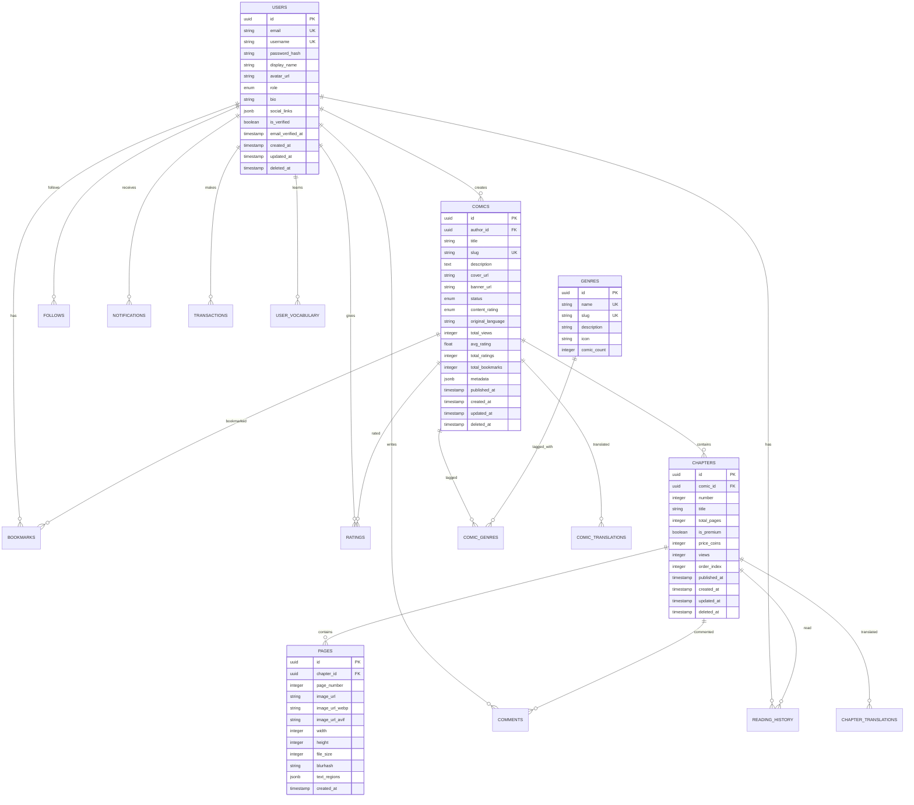

# 🗄️ Database Design – Comic Reading Platform

> **Phiên bản**: 1.0  
> **Database**: PostgreSQL 16.x  
> **ORM**: Prisma 5.x  
> **Cập nhật**: 2026-02-10

---

## 1. Tổng quan

### Nguyên tắc thiết kế
- **Normalization**: 3NF cho consistency, denormalize khi cần performance
- **Soft Delete**: Sử dụng `deleted_at` thay vì xóa vật lý
- **Audit Trail**: Mọi entity đều có `created_at`, `updated_at`
- **UUID**: Sử dụng UUID v7 cho primary key (time-sortable, unique)
- **JSONB**: Sử dụng cho flexible metadata fields

---

## 2. Entity-Relationship Diagram (ERD)



---

## 3. Chi tiết từng Bảng

### 3.1. `users` – Người dùng

```sql
CREATE TABLE users (
    id              UUID PRIMARY KEY DEFAULT gen_random_uuid(),
    email           VARCHAR(255) NOT NULL UNIQUE,
    username        VARCHAR(50) NOT NULL UNIQUE,
    password_hash   VARCHAR(255),           -- NULL nếu dùng OAuth
    display_name    VARCHAR(100) NOT NULL,
    avatar_url      VARCHAR(500),
    role            user_role NOT NULL DEFAULT 'READER',
    bio             TEXT,
    social_links    JSONB DEFAULT '{}',     -- {"facebook": "...", "twitter": "..."}
    is_verified     BOOLEAN DEFAULT FALSE,
    email_verified_at TIMESTAMP,
    
    -- OAuth
    oauth_provider  VARCHAR(50),            -- 'google', 'facebook', 'github'
    oauth_id        VARCHAR(255),
    
    -- Gamification
    coins           INTEGER DEFAULT 0,
    experience      INTEGER DEFAULT 0,
    level           INTEGER DEFAULT 1,
    
    -- Timestamps
    last_login_at   TIMESTAMP,
    created_at      TIMESTAMP NOT NULL DEFAULT NOW(),
    updated_at      TIMESTAMP NOT NULL DEFAULT NOW(),
    deleted_at      TIMESTAMP               -- Soft delete
);

CREATE TYPE user_role AS ENUM ('READER', 'AUTHOR', 'MODERATOR', 'ADMIN');

-- Indexes
CREATE INDEX idx_users_email ON users(email);
CREATE INDEX idx_users_username ON users(username);
CREATE INDEX idx_users_role ON users(role);
CREATE INDEX idx_users_oauth ON users(oauth_provider, oauth_id);
CREATE INDEX idx_users_deleted_at ON users(deleted_at) WHERE deleted_at IS NULL;
```

### 3.2. `comics` – Truyện tranh

```sql
CREATE TABLE comics (
    id                UUID PRIMARY KEY DEFAULT gen_random_uuid(),
    author_id         UUID NOT NULL REFERENCES users(id),
    title             VARCHAR(255) NOT NULL,
    slug              VARCHAR(300) NOT NULL UNIQUE,
    description       TEXT,
    cover_url         VARCHAR(500),
    banner_url        VARCHAR(500),
    status            comic_status NOT NULL DEFAULT 'DRAFT',
    content_rating    content_rating NOT NULL DEFAULT 'EVERYONE',
    original_language VARCHAR(10) DEFAULT 'vi',
    
    -- Aggregated stats (denormalized for performance)
    total_views       INTEGER DEFAULT 0,
    total_chapters    INTEGER DEFAULT 0,
    avg_rating        DECIMAL(3,2) DEFAULT 0,
    total_ratings     INTEGER DEFAULT 0,
    total_bookmarks   INTEGER DEFAULT 0,
    total_comments    INTEGER DEFAULT 0,
    
    -- Flexible metadata
    metadata          JSONB DEFAULT '{}',   -- {"alt_titles": [...], "year": 2024}
    
    -- Timestamps
    published_at      TIMESTAMP,
    last_chapter_at   TIMESTAMP,            -- Lần update chapter gần nhất
    created_at        TIMESTAMP NOT NULL DEFAULT NOW(),
    updated_at        TIMESTAMP NOT NULL DEFAULT NOW(),
    deleted_at        TIMESTAMP
);

CREATE TYPE comic_status AS ENUM ('DRAFT', 'ONGOING', 'COMPLETED', 'HIATUS', 'CANCELLED');
CREATE TYPE content_rating AS ENUM ('EVERYONE', 'TEEN', 'MATURE');

-- Indexes
CREATE INDEX idx_comics_author ON comics(author_id);
CREATE INDEX idx_comics_slug ON comics(slug);
CREATE INDEX idx_comics_status ON comics(status);
CREATE INDEX idx_comics_rating ON comics(content_rating);
CREATE INDEX idx_comics_published ON comics(published_at DESC);
CREATE INDEX idx_comics_popular ON comics(total_views DESC);
CREATE INDEX idx_comics_latest ON comics(last_chapter_at DESC NULLS LAST);
CREATE INDEX idx_comics_top_rated ON comics(avg_rating DESC) WHERE total_ratings >= 10;

-- Full-text search
CREATE INDEX idx_comics_search ON comics USING GIN (
    to_tsvector('simple', title || ' ' || COALESCE(description, ''))
);
```

### 3.3. `chapters` – Chương truyện

```sql
CREATE TABLE chapters (
    id              UUID PRIMARY KEY DEFAULT gen_random_uuid(),
    comic_id        UUID NOT NULL REFERENCES comics(id) ON DELETE CASCADE,
    number          DECIMAL(10,1) NOT NULL,  -- Hỗ trợ 10.5 cho extra chapters
    title           VARCHAR(255),
    total_pages     INTEGER DEFAULT 0,
    is_premium      BOOLEAN DEFAULT FALSE,
    price_coins     INTEGER DEFAULT 0,       -- Giá bằng coins nếu premium
    views           INTEGER DEFAULT 0,
    order_index     INTEGER NOT NULL,        -- Thứ tự hiển thị
    
    -- Timestamps
    published_at    TIMESTAMP,
    created_at      TIMESTAMP NOT NULL DEFAULT NOW(),
    updated_at      TIMESTAMP NOT NULL DEFAULT NOW(),
    deleted_at      TIMESTAMP,
    
    UNIQUE(comic_id, number)
);

CREATE INDEX idx_chapters_comic ON chapters(comic_id, order_index);
CREATE INDEX idx_chapters_published ON chapters(published_at DESC);
```

### 3.4. `pages` – Trang truyện (Ảnh)

```sql
CREATE TABLE pages (
    id              UUID PRIMARY KEY DEFAULT gen_random_uuid(),
    chapter_id      UUID NOT NULL REFERENCES chapters(id) ON DELETE CASCADE,
    page_number     INTEGER NOT NULL,
    
    -- Image variants
    image_url       VARCHAR(500) NOT NULL,     -- Original
    image_url_webp  VARCHAR(500),              -- WebP optimized
    image_url_avif  VARCHAR(500),              -- AVIF optimized
    thumbnail_url   VARCHAR(500),              -- Thumbnail
    
    -- Image metadata
    width           INTEGER,
    height          INTEGER,
    file_size       INTEGER,                   -- Bytes
    blurhash        VARCHAR(100),              -- Blur placeholder
    
    -- For bilingual features
    text_regions    JSONB DEFAULT '[]',         -- [{x, y, w, h, text, lang}]
    
    created_at      TIMESTAMP NOT NULL DEFAULT NOW(),
    
    UNIQUE(chapter_id, page_number)
);

CREATE INDEX idx_pages_chapter ON pages(chapter_id, page_number);
```

### 3.5. `genres` – Thể loại

```sql
CREATE TABLE genres (
    id              UUID PRIMARY KEY DEFAULT gen_random_uuid(),
    name            VARCHAR(100) NOT NULL UNIQUE,
    slug            VARCHAR(100) NOT NULL UNIQUE,
    description     TEXT,
    icon            VARCHAR(50),              -- Icon name/emoji
    comic_count     INTEGER DEFAULT 0,        -- Denormalized
    display_order   INTEGER DEFAULT 0,
    is_active       BOOLEAN DEFAULT TRUE,
    created_at      TIMESTAMP NOT NULL DEFAULT NOW()
);

-- Bảng liên kết n-n
CREATE TABLE comic_genres (
    comic_id        UUID NOT NULL REFERENCES comics(id) ON DELETE CASCADE,
    genre_id        UUID NOT NULL REFERENCES genres(id) ON DELETE CASCADE,
    PRIMARY KEY (comic_id, genre_id)
);

CREATE INDEX idx_comic_genres_genre ON comic_genres(genre_id);
```

**Genres mặc định:**

| Slug | Tên | Icon |
|------|-----|------|
| action | Hành động | ⚔️ |
| comedy | Hài hước | 😂 |
| drama | Kịch tính | 🎭 |
| fantasy | Giả tưởng | 🧙 |
| horror | Kinh dị | 👻 |
| romance | Tình cảm | ❤️ |
| sci-fi | Khoa học viễn tưởng | 🚀 |
| slice-of-life | Đời thường | 🌸 |
| thriller | Ly kỳ | 🔍 |
| historical | Lịch sử | 📜 |

### 3.6. `bookmarks` – Đánh dấu / Yêu thích

```sql
CREATE TABLE bookmarks (
    id              UUID PRIMARY KEY DEFAULT gen_random_uuid(),
    user_id         UUID NOT NULL REFERENCES users(id) ON DELETE CASCADE,
    comic_id        UUID NOT NULL REFERENCES comics(id) ON DELETE CASCADE,
    last_chapter_id UUID REFERENCES chapters(id),  -- Chapter đọc gần nhất
    last_page       INTEGER,                         -- Trang đọc gần nhất
    is_favorite     BOOLEAN DEFAULT FALSE,
    notify_update   BOOLEAN DEFAULT TRUE,            -- Thông báo khi có chap mới
    created_at      TIMESTAMP NOT NULL DEFAULT NOW(),
    updated_at      TIMESTAMP NOT NULL DEFAULT NOW(),
    
    UNIQUE(user_id, comic_id)
);

CREATE INDEX idx_bookmarks_user ON bookmarks(user_id, created_at DESC);
CREATE INDEX idx_bookmarks_comic ON bookmarks(comic_id);
```

### 3.7. `reading_history` – Lịch sử đọc

```sql
CREATE TABLE reading_history (
    id              UUID PRIMARY KEY DEFAULT gen_random_uuid(),
    user_id         UUID NOT NULL REFERENCES users(id) ON DELETE CASCADE,
    comic_id        UUID NOT NULL REFERENCES comics(id),
    chapter_id      UUID NOT NULL REFERENCES chapters(id),
    last_page       INTEGER DEFAULT 1,
    is_completed    BOOLEAN DEFAULT FALSE,
    reading_time    INTEGER DEFAULT 0,        -- Seconds
    read_at         TIMESTAMP NOT NULL DEFAULT NOW(),
    
    UNIQUE(user_id, chapter_id)
);

CREATE INDEX idx_reading_history_user ON reading_history(user_id, read_at DESC);
CREATE INDEX idx_reading_history_chapter ON reading_history(chapter_id);
```

### 3.8. `comments` – Bình luận

```sql
CREATE TABLE comments (
    id              UUID PRIMARY KEY DEFAULT gen_random_uuid(),
    user_id         UUID NOT NULL REFERENCES users(id),
    chapter_id      UUID NOT NULL REFERENCES chapters(id) ON DELETE CASCADE,
    parent_id       UUID REFERENCES comments(id),    -- Reply thread
    content         TEXT NOT NULL,
    
    -- Reactions count (denormalized)
    likes_count     INTEGER DEFAULT 0,
    
    is_pinned       BOOLEAN DEFAULT FALSE,
    is_spoiler      BOOLEAN DEFAULT FALSE,
    
    created_at      TIMESTAMP NOT NULL DEFAULT NOW(),
    updated_at      TIMESTAMP NOT NULL DEFAULT NOW(),
    deleted_at      TIMESTAMP
);

CREATE INDEX idx_comments_chapter ON comments(chapter_id, created_at DESC);
CREATE INDEX idx_comments_user ON comments(user_id);
CREATE INDEX idx_comments_parent ON comments(parent_id);
```

### 3.9. `ratings` – Đánh giá

```sql
CREATE TABLE ratings (
    id              UUID PRIMARY KEY DEFAULT gen_random_uuid(),
    user_id         UUID NOT NULL REFERENCES users(id),
    comic_id        UUID NOT NULL REFERENCES comics(id) ON DELETE CASCADE,
    score           SMALLINT NOT NULL CHECK (score BETWEEN 1 AND 5),
    review          TEXT,
    helpful_count   INTEGER DEFAULT 0,
    
    created_at      TIMESTAMP NOT NULL DEFAULT NOW(),
    updated_at      TIMESTAMP NOT NULL DEFAULT NOW(),
    
    UNIQUE(user_id, comic_id)
);

CREATE INDEX idx_ratings_comic ON ratings(comic_id, score);
CREATE INDEX idx_ratings_helpful ON ratings(comic_id, helpful_count DESC);
```

### 3.10. `follows` – Theo dõi Tác giả

```sql
CREATE TABLE follows (
    follower_id     UUID NOT NULL REFERENCES users(id) ON DELETE CASCADE,
    following_id    UUID NOT NULL REFERENCES users(id) ON DELETE CASCADE,
    created_at      TIMESTAMP NOT NULL DEFAULT NOW(),
    
    PRIMARY KEY (follower_id, following_id),
    CHECK (follower_id != following_id)
);

CREATE INDEX idx_follows_following ON follows(following_id);
```

### 3.11. `notifications` – Thông báo

```sql
CREATE TABLE notifications (
    id              UUID PRIMARY KEY DEFAULT gen_random_uuid(),
    user_id         UUID NOT NULL REFERENCES users(id) ON DELETE CASCADE,
    type            notification_type NOT NULL,
    title           VARCHAR(255) NOT NULL,
    content         TEXT,
    data            JSONB DEFAULT '{}',       -- {"comic_id": "...", "chapter_id": "..."}
    is_read         BOOLEAN DEFAULT FALSE,
    read_at         TIMESTAMP,
    created_at      TIMESTAMP NOT NULL DEFAULT NOW()
);

CREATE TYPE notification_type AS ENUM (
    'NEW_CHAPTER',        -- Truyện bạn follow có chap mới
    'COMMENT_REPLY',      -- Có người reply comment
    'RATING_RECEIVED',    -- Truyện bạn viết được rate
    'FOLLOW_NEW',         -- Có người follow bạn
    'SYSTEM',             -- Thông báo hệ thống
    'ACHIEVEMENT'         -- Đạt achievement
);

CREATE INDEX idx_notifications_user ON notifications(user_id, created_at DESC);
CREATE INDEX idx_notifications_unread ON notifications(user_id, is_read) WHERE is_read = FALSE;
```

### 3.12. `transactions` – Giao dịch (Phase 2)

```sql
CREATE TABLE transactions (
    id              UUID PRIMARY KEY DEFAULT gen_random_uuid(),
    user_id         UUID NOT NULL REFERENCES users(id),
    type            transaction_type NOT NULL,
    amount          DECIMAL(12,2) NOT NULL,
    currency        VARCHAR(3) DEFAULT 'VND',
    coins           INTEGER DEFAULT 0,
    status          transaction_status DEFAULT 'PENDING',
    
    -- Payment info
    payment_method  VARCHAR(50),               -- 'stripe', 'vnpay', 'momo'
    payment_id      VARCHAR(255),              -- External payment ID
    
    -- Related entity
    related_type    VARCHAR(50),               -- 'chapter_purchase', 'donation', 'subscription'
    related_id      UUID,
    
    -- Metadata
    metadata        JSONB DEFAULT '{}',
    
    created_at      TIMESTAMP NOT NULL DEFAULT NOW(),
    completed_at    TIMESTAMP
);

CREATE TYPE transaction_type AS ENUM ('DEPOSIT', 'PURCHASE', 'DONATION', 'REFUND', 'EARNING');
CREATE TYPE transaction_status AS ENUM ('PENDING', 'COMPLETED', 'FAILED', 'REFUNDED');

CREATE INDEX idx_transactions_user ON transactions(user_id, created_at DESC);
CREATE INDEX idx_transactions_status ON transactions(status);
```

### 3.13. `user_vocabulary` – Từ vựng cá nhân (Phase 2)

```sql
CREATE TABLE user_vocabulary (
    id              UUID PRIMARY KEY DEFAULT gen_random_uuid(),
    user_id         UUID NOT NULL REFERENCES users(id) ON DELETE CASCADE,
    word            VARCHAR(200) NOT NULL,
    reading         VARCHAR(200),              -- Phiên âm
    meaning         TEXT NOT NULL,
    language        VARCHAR(10) NOT NULL,       -- 'ja', 'ko', 'en', 'zh'
    context         TEXT,                       -- Câu ví dụ từ truyện
    source_page_id  UUID REFERENCES pages(id),
    
    -- Spaced Repetition
    srs_level       INTEGER DEFAULT 0,
    next_review_at  TIMESTAMP,
    ease_factor     DECIMAL(4,2) DEFAULT 2.5,
    
    created_at      TIMESTAMP NOT NULL DEFAULT NOW(),
    updated_at      TIMESTAMP NOT NULL DEFAULT NOW()
);

CREATE INDEX idx_vocabulary_user ON user_vocabulary(user_id, language);
CREATE INDEX idx_vocabulary_review ON user_vocabulary(user_id, next_review_at);
```

### 3.14. `comic_translations` & `chapter_translations` – Bản dịch (Phase 2)

```sql
CREATE TABLE comic_translations (
    id              UUID PRIMARY KEY DEFAULT gen_random_uuid(),
    comic_id        UUID NOT NULL REFERENCES comics(id) ON DELETE CASCADE,
    language        VARCHAR(10) NOT NULL,      -- 'en', 'ja', 'ko'
    title           VARCHAR(255) NOT NULL,
    description     TEXT,
    translator_id   UUID REFERENCES users(id),
    is_ai_generated BOOLEAN DEFAULT FALSE,
    status          VARCHAR(20) DEFAULT 'DRAFT',
    created_at      TIMESTAMP NOT NULL DEFAULT NOW(),
    updated_at      TIMESTAMP NOT NULL DEFAULT NOW(),
    
    UNIQUE(comic_id, language)
);

CREATE TABLE chapter_translations (
    id              UUID PRIMARY KEY DEFAULT gen_random_uuid(),
    chapter_id      UUID NOT NULL REFERENCES chapters(id) ON DELETE CASCADE,
    language        VARCHAR(10) NOT NULL,
    translator_id   UUID REFERENCES users(id),
    is_ai_generated BOOLEAN DEFAULT FALSE,
    status          VARCHAR(20) DEFAULT 'DRAFT',
    text_data       JSONB NOT NULL,            -- [{page: 1, regions: [{x,y,w,h,text}]}]
    created_at      TIMESTAMP NOT NULL DEFAULT NOW(),
    updated_at      TIMESTAMP NOT NULL DEFAULT NOW(),
    
    UNIQUE(chapter_id, language)
);
```

### 3.15. `reports` – Báo cáo vi phạm

```sql
CREATE TABLE reports (
    id              UUID PRIMARY KEY DEFAULT gen_random_uuid(),
    reporter_id     UUID NOT NULL REFERENCES users(id),
    target_type     VARCHAR(50) NOT NULL,      -- 'comic', 'chapter', 'comment', 'user'
    target_id       UUID NOT NULL,
    reason          report_reason NOT NULL,
    description     TEXT,
    status          VARCHAR(20) DEFAULT 'PENDING',
    resolved_by     UUID REFERENCES users(id),
    resolved_at     TIMESTAMP,
    resolution_note TEXT,
    created_at      TIMESTAMP NOT NULL DEFAULT NOW()
);

CREATE TYPE report_reason AS ENUM (
    'COPYRIGHT', 'INAPPROPRIATE', 'SPAM', 'HARASSMENT', 'OTHER'
);

CREATE INDEX idx_reports_status ON reports(status, created_at);
CREATE INDEX idx_reports_target ON reports(target_type, target_id);
```

---

## 4. Chiến lược Indexing

### Indexes quan trọng nhất

| Bảng | Index | Mục đích |
|------|-------|----------|
| `comics` | `(published_at DESC)` | Trang chủ – truyện mới nhất |
| `comics` | `(total_views DESC)` | Truyện phổ biến nhất |
| `comics` | `(avg_rating DESC) WHERE total_ratings >= 10` | Top rated |
| `comics` | `GIN(tsvector)` | Full-text search |
| `chapters` | `(comic_id, order_index)` | Danh sách chapter |
| `pages` | `(chapter_id, page_number)` | Đọc truyện |
| `bookmarks` | `(user_id, created_at DESC)` | Tủ truyện của user |
| `reading_history` | `(user_id, read_at DESC)` | Lịch sử đọc |
| `notifications` | `(user_id, is_read) WHERE is_read = FALSE` | Badge đếm thông báo |

---

## 5. Caching Strategy (Redis)

```
┌────────────────────────────────────────────────────────┐
│                   REDIS CACHE LAYERS                    │
├────────────────────────────────────────────────────────┤
│                                                         │
│  Session Store                                          │
│  ├── session:{session_id} → user data       TTL: 24h   │
│                                                         │
│  Hot Data Cache                                         │
│  ├── comic:{id} → comic details             TTL: 5min  │
│  ├── comic:{id}:chapters → chapter list     TTL: 5min  │
│  ├── chapter:{id}:pages → page URLs         TTL: 1h    │
│  ├── user:{id}:profile → user profile       TTL: 15min │
│                                                         │
│  Aggregation Cache                                      │
│  ├── homepage:trending → trending comics    TTL: 10min  │
│  ├── homepage:latest → latest updates       TTL: 5min   │
│  ├── homepage:top_rated → top rated         TTL: 1h     │
│  ├── genre:{slug}:comics → comics by genre  TTL: 10min  │
│                                                         │
│  Counter Cache                                          │
│  ├── comic:{id}:views → view count          Persist     │
│  ├── chapter:{id}:views → view count        Persist     │
│                                                         │
│  Rate Limiting                                          │
│  ├── ratelimit:{ip}:{endpoint} → count      TTL: 1min  │
│                                                         │
└────────────────────────────────────────────────────────┘
```

---

## 6. Database Migration Strategy

### Quy tắc Migration

1. **Luôn backward-compatible**: Migration mới không được break code cũ
2. **Tách DDL và DML**: Schema changes và data changes là 2 migration riêng
3. **Review trước khi chạy Production**: Mọi migration cần code review
4. **Backup trước khi migrate**: Luôn backup database trước migration

### Prisma Migration Commands

```bash
# Tạo migration mới
npx prisma migrate dev --name add_user_vocabulary

# Xem trạng thái migration
npx prisma migrate status

# Chạy migration trên production
npx prisma migrate deploy

# Reset database (DEV only)
npx prisma migrate reset
```

---

## 7. Seed Data

```bash
# File: prisma/seed.ts
# Chạy: npx prisma db seed

# Seed data bao gồm:
# - Admin user mặc định
# - Danh sách genres
# - Sample comics (dev environment)
# - Sample chapters và pages
```

| Seed | Môi trường | Mô tả |
|------|-----------|-------|
| Genres | All | 10+ thể loại mặc định |
| Admin Account | All | Tài khoản admin đầu tiên |
| Sample Comics | Dev/Staging | 5-10 truyện mẫu với chapters |
| Test Users | Dev | 10 users với các roles khác nhau |
