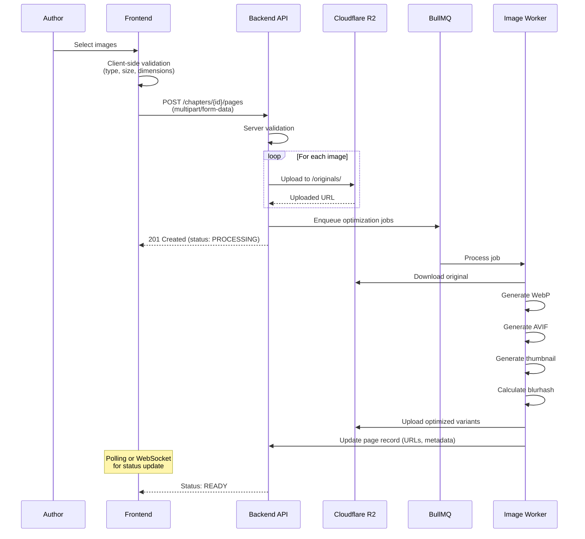
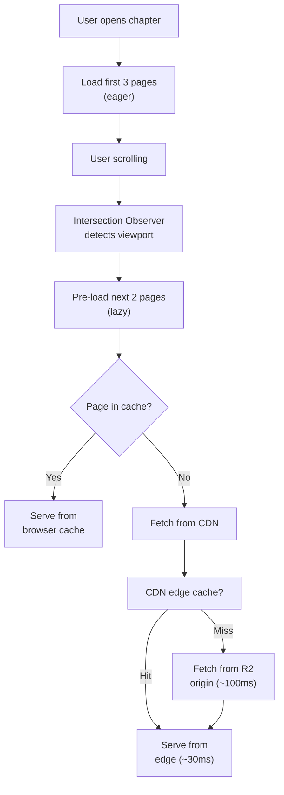

# 📁 File Storage & CDN – Comic Reading Platform

> **Phiên bản**: 1.0  
> **Storage**: Cloudflare R2  
> **CDN**: Cloudflare  
> **Cập nhật**: 2026-02-10

---

## 1. Tổng quan

### 1.1. Thách thức

- Web truyện tranh là **ứng dụng image-heavy** — hàng triệu ảnh cần lưu trữ
- Mỗi chapter có 20-50 trang, mỗi trang 500KB-3MB
- Cần serve nhanh cho users ở Việt Nam và khu vực

### 1.2. Giải pháp

```
┌─────────────────────────────────────────────────────┐
│                 IMAGE PIPELINE                       │
│                                                      │
│  Upload → Validate → Store Original → Optimize       │
│                                    ↓                 │
│                              ┌───────────┐           │
│                              │ Cloudflare │           │
│                              │    R2      │           │
│                              │ (Storage)  │           │
│                              └─────┬─────┘           │
│                                    ↓                 │
│                              ┌───────────┐           │
│                              │ Cloudflare │           │
│                              │   CDN      │           │
│                              │ (Delivery) │           │
│                              └─────┬─────┘           │
│                                    ↓                 │
│                               End User               │
│                                                      │
└─────────────────────────────────────────────────────┘
```

---

## 2. Storage Structure (Cloudflare R2)

### 2.1. Bucket Organization

```
comics-platform-storage/
├── covers/
│   ├── {comic_id}/
│   │   ├── original.jpg          # Original upload
│   │   ├── cover.webp            # Optimized (800x1200)
│   │   ├── cover-sm.webp         # Small (400x600)
│   │   └── cover-thumb.webp      # Thumbnail (200x300)
│   └── ...
├── banners/
│   ├── {comic_id}/
│   │   ├── original.jpg
│   │   └── banner.webp           # Optimized (1920x600)
│   └── ...
├── chapters/
│   ├── {comic_id}/
│   │   ├── {chapter_id}/
│   │   │   ├── originals/        # Original uploads
│   │   │   │   ├── 001.jpg
│   │   │   │   ├── 002.jpg
│   │   │   │   └── ...
│   │   │   ├── webp/             # WebP optimized
│   │   │   │   ├── 001.webp
│   │   │   │   ├── 002.webp
│   │   │   │   └── ...
│   │   │   ├── avif/             # AVIF optimized
│   │   │   │   ├── 001.avif
│   │   │   │   └── ...
│   │   │   └── thumbnails/       # Thumbnail previews
│   │   │       ├── 001-thumb.webp
│   │   │       └── ...
│   │   └── ...
│   └── ...
├── avatars/
│   ├── {user_id}/
│   │   ├── original.jpg
│   │   ├── avatar.webp           # 256x256
│   │   └── avatar-sm.webp        # 64x64
│   └── ...
└── temp/                          # Temporary uploads (TTL: 24h)
    └── ...
```

### 2.2. Naming Convention

| File Type | Pattern | Ví dụ |
|-----------|---------|-------|
| Cover | `covers/{comicId}/cover.webp` | `covers/abc-123/cover.webp` |
| Chapter page | `chapters/{comicId}/{chapterId}/webp/001.webp` | `chapters/abc-123/def-456/webp/001.webp` |
| Avatar | `avatars/{userId}/avatar.webp` | `avatars/ghi-789/avatar.webp` |

---

## 3. Upload Process

### 3.1. Upload Flow



### 3.2. Upload Constraints

| Parameter | Limit | Lý do |
|-----------|-------|-------|
| **Max file size** | 10MB per image | Cân bằng chất lượng & bandwidth |
| **Allowed types** | JPG, PNG, WebP | Hỗ trợ phổ biến |
| **Max pages per upload** | 50 | Tránh timeout |
| **Max concurrent uploads** | 5 | Server resources |
| **Min dimensions** | 400x400px | Đảm bảo chất lượng |
| **Max dimensions** | 5000x10000px | Giới hạn hợp lý |

### 3.3. Client-side Pre-processing

Trước khi upload, frontend nên:

1. **Validate** file type và size
2. **Resize** nếu > 3000px width (giảm upload time)
3. **Show preview** để author xác nhận thứ tự
4. **Drag & drop** để sắp xếp lại thứ tự trang
5. **Progress bar** cho từng file

---

## 4. Image Optimization

### 4.1. Optimization Pipeline (Background Worker)

```
Original Image (JPG/PNG, ~2MB)
    │
    ├──→ WebP (quality: 85%, ~500KB)     ← Primary format
    │      └── Max width: 1200px
    │
    ├──→ AVIF (quality: 75%, ~350KB)     ← Best compression
    │      └── Max width: 1200px
    │
    ├──→ Thumbnail (WebP, ~20KB)          ← For chapter preview
    │      └── Max width: 200px
    │
    └──→ Blurhash string                  ← Loading placeholder
           └── ~30 bytes
```

### 4.2. Format Comparison

| Format | Size (relative) | Browser Support | Quality |
|--------|----------------|-----------------|---------|
| JPEG (original) | 100% | 99%+ | Baseline |
| WebP | ~40-50% | 97%+ | Excellent |
| AVIF | ~30-40% | 92%+ | Best |

### 4.3. Responsive Images (Frontend)

```html
<picture>
  <!-- AVIF for modern browsers -->
  <source 
    type="image/avif" 
    srcset="page-001.avif"
  />
  <!-- WebP fallback -->
  <source 
    type="image/webp" 
    srcset="page-001.webp"
  />
  <!-- JPEG última fallback -->
  
</picture>
```

### 4.4. Công cụ Optimization

| Tool | Mục đích |
|------|----------|
| **Sharp** (Node.js) | Resize, convert, optimize images |
| **blurhash** | Generate blur placeholder hash |
| **probe-image-size** | Lấy dimensions mà không cần download full |

---

## 5. CDN Configuration (Cloudflare)

### 5.1. Cache Rules

| Path Pattern | Cache TTL | Mô tả |
|-------------|-----------|-------|
| `/covers/*` | 30 days | Cover images ít thay đổi |
| `/chapters/*/webp/*` | 365 days | Chapter pages immutable |
| `/chapters/*/avif/*` | 365 days | Chapter pages immutable |
| `/avatars/*` | 7 days | Avatar có thể thay đổi |
| `/temp/*` | No cache | Temporary files |

### 5.2. Cache Headers

```
# Immutable assets (chapter pages)
Cache-Control: public, max-age=31536000, immutable

# Semi-static (covers, avatars)
Cache-Control: public, max-age=86400, stale-while-revalidate=604800

# Dynamic (API responses)
Cache-Control: no-store
```

### 5.3. Cloudflare Features Used

| Feature | Mục đích |
|---------|----------|
| **CDN** | Edge caching, global distribution |
| **Polish** | Auto image optimization |
| **Argo** | Smart routing, faster origin fetch |
| **WAF** | Web Application Firewall |
| **Bot Management** | Chống hotlinking, scraping |
| **Page Rules** | Custom cache behavior per path |

### 5.4. Custom Domain Setup

```
cdn.comicplatform.vn → Cloudflare R2 custom domain
                       ├── /covers/...
                       ├── /chapters/...
                       └── /avatars/...
```

---

## 6. Image Delivery Strategy

### 6.1. Reading Experience Optimization



### 6.2. Lazy Loading Strategy

| Position | Strategy |
|----------|----------|
| Pages 1-3 | **Eager load** — hiện ngay |
| Pages 4-5 | **Pre-fetch** — tải trong background |
| Pages 6+ | **Lazy load** — tải khi user scroll gần |
| Thumbnail | **Blurhash** — placeholder cho đến khi image loaded |

### 6.3. Offline Support (PWA)

```
Service Worker caching:
├── READ chapters — cache after first read
├── BOOKMARKED chapters — pre-cache on bookmark
├── Covers — cache on homepage visit
└── Static assets — cache on install

Storage budget:
├── Total: 200MB max
├── Per chapter: ~5-15MB
└── Auto-evict: LRU when over budget
```

---

## 7. Bảo mật Storage

### 7.1. Access Control

| File Type | Access | Auth Required |
|-----------|--------|--------------|
| Covers | Public | ❌ |
| Free chapter pages | Public | ❌ |
| Premium chapter pages | Signed URL | ✅ |
| Avatars | Public | ❌ |
| Original uploads | Private | Admin only |

### 7.2. Signed URLs (Premium Content)

```
Cho premium chapters, sử dụng Cloudflare Signed URLs:

https://cdn.comicplatform.vn/chapters/{id}/webp/001.webp
  ?token=abc123
  &exp=1707556500        (hết hạn sau 1 giờ)

→ CDN kiểm tra token + expiry trước khi serve
→ Chống hotlinking, share link
```

### 7.3. Anti-Hotlinking

```
Cloudflare Page Rule:
  - Check Referer header
  - Block if not from *.comicplatform.vn
  - Exception: empty Referer (direct access allowed)
```

### 7.4. Content Moderation

```
Upload flow:
  1. Author uploads image
  2. Store in /temp/ (private)
  3. Send to AI moderation (Google Cloud Vision)
     ├── Check: adult content
     ├── Check: violence level
     └── Check: copyright watermarks
  4. If PASS → move to /chapters/ (public)
  5. If FAIL → notify author, keep in /temp/
  6. If UNCERTAIN → queue for manual review
```

---

## 8. Cost Estimation

### 8.1. Cloudflare R2 Pricing

| Operation | Price |
|-----------|-------|
| Storage | $0.015 / GB / month |
| Class A (writes) | $4.50 / million |
| Class B (reads) | $0.36 / million |
| Egress | **FREE** ✅ |

### 8.2. Estimated Costs

| Phase | Storage | Reads/month | Cost/month |
|-------|---------|-------------|------------|
| MVP (500 comics) | ~50 GB | ~1M | ~$1-2 |
| Growth (2K comics) | ~500 GB | ~10M | ~$10-15 |
| Scale (10K comics) | ~5 TB | ~100M | ~$100-150 |

### 8.3. Nguyên lý giảm chi phí

| Chiến lược | Tiết kiệm |
|-----------|-----------|
| **CDN cache** | 90%+ reads từ edge, ít origin reads |
| **Image optimization** | Giảm 50-70% storage size |
| **Lazy loading** | Chỉ fetch ảnh user thực sự xem |
| **R2 free egress** | Không phí data transfer (vs S3) |
| **Lifecycle policy** | Tự động xóa /temp/ sau 24h |

---

## 9. Monitoring & Alerts

### 9.1. Metrics to Track

| Metric | Alert Threshold |
|--------|----------------|
| Storage usage | > 80% of budget |
| Upload failure rate | > 5% |
| Image optimization time | > 30s per image |
| CDN cache hit ratio | < 85% |
| 4xx errors on CDN | > 100/min |
| 5xx errors on CDN | > 10/min |

### 9.2. Dashboard

Cloudflare Analytics dashboard cho:
- Total requests, cache hit ratio
- Bandwidth saved by cache
- Geographic distribution
- Error rates
