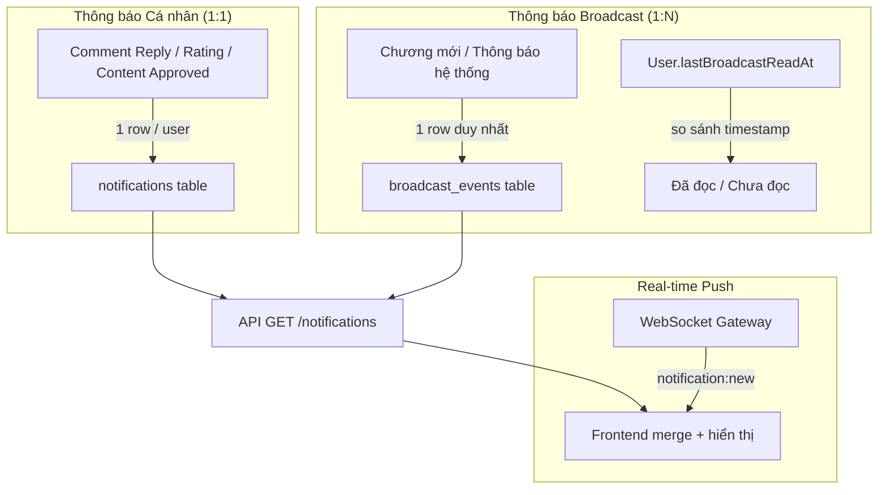

# Trung tâm Thông báo (Notification Center) — v3 Final

Xây dựng hệ thống thông báo hoàn chỉnh cho nền tảng OWOC với kiến trúc **hybrid**: thông báo cá nhân (fan-out on write) + thông báo broadcast (fan-out on read). Real-time qua WebSocket.

---

## Kiến trúc đã xác nhận



| Loại | Bảng | Cách hoạt động | Ví dụ |
|------|------|----------------|-------|
| **Cá nhân** | `notifications` | 1 row / 1 user, có `isRead` riêng | Comment reply, Rating, Approved, Rejected |
| **Broadcast** | `broadcast_events` | 1 row duy nhất, check `lastBroadcastReadAt` | Chương mới, Thông báo hệ thống |

---

## Proposed Changes

### Component 1: Database Schema

#### [MODIFY] [schema.prisma](file:///e:/Project/Comics/apps/api/prisma/schema.prisma)

**1. Thêm field `lastBroadcastReadAt` vào model `User`:**
```prisma
model User {
  // ... existing fields ...
  lastBroadcastReadAt DateTime? @map("last_broadcast_read_at")
  
  // ... existing relations ...
  broadcastEvents BroadcastEvent[]  // broadcast events do user tạo (tác giả)
}
```

**2. Thêm model `BroadcastEvent`:**
```prisma
model BroadcastEvent {
  id         String           @id @default(uuid()) @db.Uuid
  type       NotificationType
  title      String           @db.VarChar(255)
  content    String?
  data       Json             @default("{}") @db.JsonB
  targetType String           @map("target_type") @db.VarChar(50)  // "COMIC_FOLLOWERS" | "ALL_USERS"
  targetId   String?          @map("target_id") @db.Uuid
  actorId    String?          @map("actor_id") @db.Uuid            // ai tạo event (tác giả)
  createdAt  DateTime         @default(now()) @map("created_at")

  actor User? @relation(fields: [actorId], references: [id])

  @@index([targetType, targetId, createdAt(sort: Desc)])
  @@index([createdAt(sort: Desc)])
  @@map("broadcast_events")
}
```

**Target types:**
- `COMIC_FOLLOWERS` — gửi cho users đã bookmark truyện (với `notifyUpdate = true`). `targetId` = `comicId`
- `ALL_USERS` — gửi cho toàn bộ users. `targetId` = null

---

### Component 2: Backend — Notification Module

#### [NEW] [notification.module.ts](file:///e:/Project/Comics/apps/api/src/notification/notification.module.ts)
- Đăng ký: `NotificationService`, `NotificationController`, `NotificationGateway`
- Import: `PrismaModule`
- Export: `NotificationService`, `NotificationGateway` (để module khác inject)

#### [NEW] [dto/notification.dto.ts](file:///e:/Project/Comics/apps/api/src/notification/dto/notification.dto.ts)
```typescript
class NotificationQueryDto {
  page?: number;       // default 1
  limit?: number;      // default 20, max 50
  type?: NotificationType;  // filter theo loại (optional)
}
```

#### [NEW] [notification.service.ts](file:///e:/Project/Comics/apps/api/src/notification/notification.service.ts)

**Methods chính:**

| Method | Mô tả |
|--------|--------|
| `getAll(userId, query)` | Lấy danh sách thông báo (merge cá nhân + broadcast), phân trang |
| `getUnreadCount(userId)` | Đếm tổng chưa đọc (personal unread + broadcast unread) |
| `markAsRead(userId, id)` | Đánh dấu 1 notification cá nhân đã đọc |
| `markAllAsRead(userId)` | Đánh dấu tất cả đã đọc (personal: update `isRead` + broadcast: update `lastBroadcastReadAt`) |
| `deleteNotification(userId, id)` | Xóa 1 notification cá nhân |
| `createPersonal(data)` | Tạo thông báo cá nhân → lưu DB → push WebSocket |
| `createBroadcast(data)` | Tạo broadcast event → lưu DB → push WebSocket cho users online |

**Logic `getAll()` — merge 2 nguồn:**
```typescript
async getAll(userId: string, query: NotificationQueryDto) {
  const user = await this.prisma.user.findUnique({
    where: { id: userId },
    select: { lastBroadcastReadAt: true }
  });

  // 1. Lấy personal notifications
  const personalNotifications = await this.prisma.notification.findMany({
    where: { userId, ...(query.type && { type: query.type }) },
    orderBy: { createdAt: 'desc' },
    take: query.limit,
  });

  // 2. Lấy broadcast events liên quan đến user
  const broadcastEvents = await this.getBroadcastsForUser(userId, query.type);

  // 3. Merge, sort by createdAt desc, paginate
  // 4. Với mỗi broadcast: isRead = createdAt <= lastBroadcastReadAt
  return merged;
}
```

**Logic `getBroadcastsForUser()` — query broadcast events:**
```typescript
async getBroadcastsForUser(userId: string, typeFilter?: NotificationType) {
  // Lấy comicIds mà user đã bookmark với notifyUpdate = true
  const bookmarks = await this.prisma.bookmark.findMany({
    where: { userId, notifyUpdate: true },
    select: { comicId: true, createdAt: true },
  });

  // Query broadcast_events:
  // - targetType = 'COMIC_FOLLOWERS' AND targetId IN (bookmarked comicIds) AND createdAt > bookmark.createdAt
  // - OR targetType = 'ALL_USERS'
  // - Filter theo type nếu có
}
```

**Logic `getUnreadCount()`:**
```typescript
async getUnreadCount(userId: string) {
  const personalUnread = await this.prisma.notification.count({
    where: { userId, isRead: false },
  });
  
  const broadcastUnread = // count broadcasts chưa đọc (createdAt > lastBroadcastReadAt)
  
  return personalUnread + broadcastUnread;
}
```

#### [NEW] [notification.controller.ts](file:///e:/Project/Comics/apps/api/src/notification/notification.controller.ts)

| Method | Endpoint | Mô tả |
|--------|----------|--------|
| `GET` | `/notifications` | Danh sách thông báo merged (phân trang + filter) |
| `GET` | `/notifications/unread-count` | Tổng số chưa đọc |
| `PATCH` | `/notifications/:id/read` | Đánh dấu 1 cá nhân đã đọc |
| `PATCH` | `/notifications/read-all` | Đánh dấu tất cả đã đọc |
| `DELETE` | `/notifications/:id` | Xóa 1 notification cá nhân |

Tất cả yêu cầu `@UseGuards(JwtAuthGuard)`.

---

### Component 3: Backend — WebSocket Gateway

#### [NEW] [notification.gateway.ts](file:///e:/Project/Comics/apps/api/src/notification/notification.gateway.ts)

```typescript
@WebSocketGateway({ cors: { origin: [...], credentials: true } })
export class NotificationGateway implements OnGatewayConnection, OnGatewayDisconnect {
  @WebSocketServer() server: Server;
  
  // Map userId → Set<socketId> (1 user nhiều tab)
  private userSockets: Map<string, Set<string>>;
  
  handleConnection(client: Socket)    // Xác thực JWT
  handleDisconnect(client: Socket)    // Cleanup
  
  // Push cho 1 user cụ thể
  sendToUser(userId: string, event: string, data: any)
  
  // Push cho nhiều users (broadcast chapter mới)
  sendToUsers(userIds: string[], event: string, data: any)
}
```

**Events server → client:**
| Event | Khi nào | Payload |
|-------|---------|---------|
| `notification:new` | Có thông báo mới | `{ id, type, title, content, data, createdAt }` |
| `notification:unread-count` | Sau khi push new | `{ count: number }` |

> [!NOTE]
> WebSocket chỉ dùng để **push** thông báo mới. Các thao tác CRUD (đọc, xóa...) vẫn qua REST API.

---

### Component 4: Backend — Tích hợp tạo Notification

#### [MODIFY] [comment.service.ts](file:///e:/Project/Comics/apps/api/src/comment/comment.service.ts)
- Inject `NotificationService`
- Khi tạo reply (có `parentId`): gọi `createPersonal()` → `COMMENT_REPLY` cho tác giả comment gốc
- Bỏ qua nếu reply chính mình

#### [MODIFY] [rating.service.ts](file:///e:/Project/Comics/apps/api/src/rating/rating.service.ts)
- Inject `NotificationService`
- Khi đánh giá truyện: gọi `createPersonal()` → `RATING_RECEIVED` cho tác giả truyện
- Bỏ qua nếu tự đánh giá truyện mình

#### [MODIFY] [comment.module.ts](file:///e:/Project/Comics/apps/api/src/comment/comment.module.ts) + [rating.module.ts](file:///e:/Project/Comics/apps/api/src/rating/rating.module.ts)
- Import `NotificationModule`

#### [MODIFY] [app.module.ts](file:///e:/Project/Comics/apps/api/src/app.module.ts)
- Import `NotificationModule`

> [!NOTE]
> **Chưa tích hợp broadcast chương mới** trong phiên này. Logic publish chapter hiện khá phức tạp (qua moderation flow). Sau khi notification module hoạt động ổn, sẽ thêm `createBroadcast()` vào chapter/moderation service ở phiên sau.
>
> **Moderation service** đã tạo notification trực tiếp qua Prisma — tạm giữ nguyên, sau refactor dùng `NotificationService` để có WebSocket push.

---

### Component 5: Frontend — Socket.IO Client + Store

#### [NEW] [notification-store.ts](file:///e:/Project/Comics/apps/web/src/stores/notification-store.ts)

```typescript
interface NotificationItem {
  id: string;
  type: NotificationType;
  title: string;
  content: string | null;
  data: Record<string, any>;
  isRead: boolean;
  createdAt: string;
  source: 'personal' | 'broadcast';  // để phân biệt khi xử lý
}

interface NotificationState {
  notifications: NotificationItem[];
  unreadCount: number;
  isLoading: boolean;
  hasNext: boolean;
  page: number;
  activeFilter: NotificationType | 'ALL';

  fetchNotifications(reset?: boolean): Promise<void>;
  fetchUnreadCount(): Promise<void>;
  markAsRead(id: string): Promise<void>;
  markAllAsRead(): Promise<void>;
  deleteNotification(id: string): Promise<void>;
  setFilter(type: NotificationType | 'ALL'): void;
  addRealTimeNotification(notification: NotificationItem): void;
}
```

#### [NEW] [socket-provider.tsx](file:///e:/Project/Comics/apps/web/src/components/providers/socket-provider.tsx)
- Kết nối Socket.IO khi user đã login (lấy token từ `useAuthStore`)
- Lắng nghe `notification:new` → gọi `addRealTimeNotification()`
- Lắng nghe `notification:unread-count` → cập nhật badge
- Tự reconnect khi mất kết nối
- Disconnect khi logout

#### [MODIFY] [layout.tsx](file:///e:/Project/Comics/apps/web/src/app/layout.tsx)
- Thêm `<SocketProvider>` bên trong `<AuthProvider>`

---

### Component 6: Frontend — Notification Bell (Header)

#### [NEW] [notification-bell.tsx](file:///e:/Project/Comics/apps/web/src/components/layout/notification-bell.tsx)

**Dropdown Panel:**
```
┌──────────────────────────────────────┐
│ 🔔 Thông báo               Đọc tất cả │
├──────────────────────────────────────┤
│ [Tất cả] [Bình luận] [Hệ thống] ... │
├──────────────────────────────────────┤
│ 🟣  NguyenVanA đã trả lời bình      │
│     luận của bạn...                  │
│     2 phút trước                  ●  │
├──────────────────────────────────────┤
│ 🟢  Truyện "ABC" đã được duyệt!     │
│     1 giờ trước                      │
├──────────────────────────────────────┤
│         Xem tất cả thông báo →      │
└──────────────────────────────────────┘
```

- Badge đỏ + unread count (hiện "99+" nếu > 99)
- Tối đa 10 items gần nhất
- Click → mark as read + điều hướng đến trang liên quan
- Unread items: nền highlight + dấu chấm xanh
- Animation slide-up khi mở

#### [MODIFY] [header.tsx](file:///e:/Project/Comics/apps/web/src/components/layout/header.tsx)
- Thêm `<NotificationBell />` cạnh nút search (chỉ hiện khi đã login)

#### [MODIFY] [studio-header.tsx](file:///e:/Project/Comics/apps/web/src/components/studio/studio-header.tsx)
- Thêm `<NotificationBell />` (vì header chính bị ẩn ở `/studio`)

---

### Component 7: Frontend — Trang Thông báo toàn trang

#### [NEW] [page.tsx](file:///e:/Project/Comics/apps/web/src/app/notifications/page.tsx)

Trang `/notifications`:
- Filter tabs theo loại thông báo
- Nhóm theo ngày (Hôm nay, Hôm qua, Tuần này, Cũ hơn)
- Infinite scroll / load more
- Skeleton loading
- Empty state
- Click → mark as read + điều hướng

**Icon + Color mapping:**

| Type | Icon | Màu | Label |
|------|------|-----|-------|
| `COMMENT_REPLY` | `fa-comment` | Violet | Bình luận |
| `RATING_RECEIVED` | `fa-star` | Amber | Đánh giá |
| `NEW_CHAPTER` | `fa-book-open` | Blue | Chương mới |
| `FOLLOW_NEW` | `fa-user-plus` | Green | Theo dõi |
| `CONTENT_APPROVED` | `fa-circle-check` | Emerald | Đã duyệt |
| `CONTENT_REJECTED` | `fa-circle-xmark` | Red | Từ chối |
| `ACHIEVEMENT` | `fa-trophy` | Yellow | Thành tựu |
| `SYSTEM` | `fa-bullhorn` | Slate | Hệ thống |

---

## Dependencies cần cài

```bash
# Backend - WebSocket
cd apps/api && pnpm add @nestjs/websockets @nestjs/platform-socket.io socket.io

# Frontend - Socket.IO client  
cd apps/web && pnpm add socket.io-client
```

---

## Thứ tự Implementation

| # | Task | Phụ thuộc |
|---|------|-----------|
| 1 | Schema: thêm `BroadcastEvent` + `lastBroadcastReadAt` trên User | — |
| 2 | `prisma migrate dev` | 1 |
| 3 | Backend: `NotificationModule` (Service + Controller + DTO) | 2 |
| 4 | Backend: `NotificationGateway` (WebSocket) | 3 |
| 5 | Backend: Tích hợp vào `CommentService` + `RatingService` | 3 |
| 6 | Frontend: Install `socket.io-client` | — |
| 7 | Frontend: `notification-store.ts` | 6 |
| 8 | Frontend: `socket-provider.tsx` + update layout | 7 |
| 9 | Frontend: `notification-bell.tsx` + update headers | 7, 8 |
| 10 | Frontend: `/notifications` page | 7 |

---

## Verification Plan

### Automated
```bash
cd apps/api && npx tsc --noEmit
cd apps/web && npx next build
```

### Manual
1. Mở 2 tab → tạo comment reply → tác giả comment gốc nhận notification **real-time**
2. Đánh giá truyện → tác giả nhận notification **ngay lập tức**
3. Header hiện badge đỏ + đúng số unread
4. Click notification trong dropdown → điều hướng đúng + mark as read
5. Vào `/notifications` → filter, load more, nhóm ngày hoạt động
6. Click "Đọc tất cả" → tất cả read, badge = 0
7. Logout → WebSocket disconnect, login lại → reconnect + badge cập nhật
