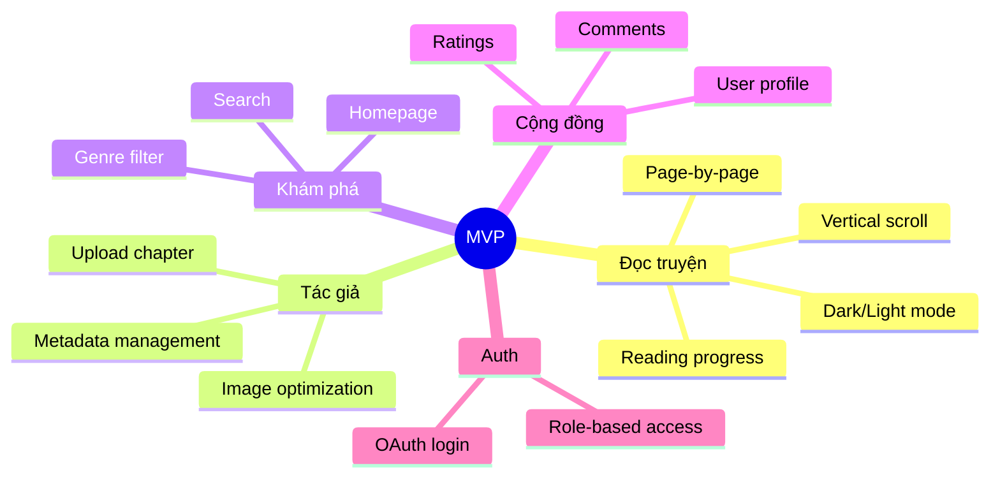

# 📖 Project Overview – Comic Reading Platform

> **Tên dự án**: Nền tảng Đọc Truyện Tranh Online  
> **Phiên bản tài liệu**: 1.0  
> **Cập nhật**: 2026-02-10

---

## 1. Tầm nhìn (Vision)

Xây dựng **nền tảng đọc truyện tranh online hàng đầu Việt Nam**, nơi:
- **Tác giả Việt** có thể sáng tác, xuất bản và kiếm thu nhập từ tác phẩm
- **Độc giả** được trải nghiệm đọc truyện mượt mà, đa ngôn ngữ, kết hợp học ngoại ngữ
- **Cộng đồng** yêu truyện tranh được kết nối, thảo luận và phát triển cùng nhau

---

## 2. Sứ mệnh (Mission)

> *"Democratize comic creation & reading — Mang truyện tranh đến mọi người, từ tác giả đến độc giả."*

- Hỗ trợ tác giả Việt Nam từ khi bắt đầu sáng tác đến khi có thu nhập ổn định
- Cung cấp trải nghiệm đọc truyện chất lượng cao, legally và miễn phí/giá rẻ
- Kết hợp giáo dục (học ngoại ngữ) với giải trí

---

## 3. Unique Selling Points (USP)

| # | USP | Mô tả | Đối thủ thiếu |
|---|-----|-------|---------------|
| 1 | **Vườn ươm Tác giả Việt** | Platform chính thức cho tác giả indie Việt Nam xuất bản | Hầu hết web truyện VN là lậu |
| 2 | **Edutainment – Học ngoại ngữ qua truyện** | Đọc truyện song ngữ, tra từ, flashcard | Không web truyện nào có |
| 3 | **AI-Powered Translation** | Dịch truyện tự động bằng AI, hỗ trợ translator | Dịch thủ công, chậm |
| 4 | **Cộng đồng Review chất lượng** | Hệ thống review, rating, reading group | Chỉ có comment đơn giản |
| 5 | **Monetization minh bạch** | Tác giả nhận tiền trực tiếp, transparent revenue | Không rõ ràng |

---

## 4. Đối tượng Mục tiêu (Target Audience)

### 4.1. Độc giả (Readers)

| Nhóm | Độ tuổi | Nhu cầu chính | Đặc điểm |
|------|---------|---------------|----------|
| **Gen Z** | 15-25 | Đọc truyện miễn phí/giá rẻ, tương tác cộng đồng | Mobile-first, active on social media |
| **Millennials** | 25-35 | Truyện chất lượng, sẵn sàng trả tiền, nostalgia | Có thu nhập, quality-conscious |
| **Người học ngoại ngữ** | 15-40 | Học qua giải trí, phương pháp mới | Sẵn sàng trả phí nếu hiệu quả |

### 4.2. Tác giả (Authors)

| Nhóm | Mô tả | Nhu cầu |
|------|-------|---------|
| **Indie Artists** | Họa sĩ tự do, chưa có publisher | Platform xuất bản, audience, thu nhập |
| **Hobby Artists** | Vẽ truyện như sở thích | Chia sẻ tác phẩm, nhận feedback |
| **Translators** | Dịch truyện ngoại | Công cụ hỗ trợ, kiếm tiền từ bản dịch |

---

## 5. Phân tích Đối thủ (Competitor Analysis)

| Đối thủ | Điểm mạnh | Điểm yếu | Cơ hội cho ta |
|---------|-----------|----------|---------------|
| **Webtoon** | Brand lớn, nhiều truyện gốc | Ít truyện Việt, không focus VN | Thị trường VN chưa bị thống trị |
| **Truyện lậu (NetTruyen...)** | Kho truyện khổng lồ, miễn phí | Bất hợp pháp, UX kém, quảng cáo spam | Cung cấp alternative hợp pháp, UX tốt |
| **Comicola** | Truyện Việt chính thống | App-only, ít tính năng cộng đồng | Web-based, nhiều tính năng hơn |
| **Tapas/Tappytoon** | Model paid chapter tốt | Tiếng Anh only | Song ngữ, thị trường VN |

---

## 6. Mô hình Kinh doanh (Business Model)

```
┌─────────────────────────────────────────────────────────┐
│                   REVENUE STREAMS                        │
├───────────────┬───────────────┬───────────────┬─────────┤
│   Freemium    │  Transaction  │  Advertising  │  Other  │
│   Model       │    Fees       │               │         │
├───────────────┼───────────────┼───────────────┼─────────┤
│ • Free tier   │ • 10-20% phí  │ • Banner ads  │ • Merch │
│   (ads)       │   từ donate   │ • Rewarded    │ • API   │
│ • Premium     │ • Phí mua     │   video ads   │   B2B   │
│   $2-5/month  │   chapter     │ • Sponsored   │         │
│   (ad-free)   │               │   content     │         │
└───────────────┴───────────────┴───────────────┴─────────┘
```

### Chi tiết Monetization

| Nguồn | % Revenue (dự kiến) | Giai đoạn |
|-------|---------------------|-----------|
| Premium Subscription | 40% | Phase 2+ |
| Transaction Fee (donate, mua chapter) | 25% | Phase 2+ |
| Advertising | 20% | Phase 1 (MVP) |
| Affiliate (merch, sách giấy) | 10% | Phase 3 |
| Enterprise (white-label) | 5% | Phase 3+ |

---

## 7. Tính năng Chính theo Phase

### Phase 1 – MVP (3-4 tháng)



### Phase 2 – Growth (3-4 tháng)
- 💰 Monetization (tipping, premium chapters, subscription)
- 🌐 Bilingual mode (học ngoại ngữ)
- 📚 Vocabulary tool
- 📊 Author analytics dashboard

### Phase 3 – Advanced (3-4 tháng)
- 🤖 AI Translation Assistant
- 🎯 Smart Recommendations
- 👥 Reading Groups
- 🏆 Events & Contests

---

## 8. Metrics & KPIs

### North Star Metric
> **Monthly Active Readers (MAR)** — Số lượng độc giả hoạt động hàng tháng

### Key Metrics theo Phase

| Phase | Metric | Target |
|-------|--------|--------|
| MVP | Registered Users | 5,000 |
| MVP | Active Authors | 100 |
| MVP | Published Comics | 500 |
| MVP | Monthly Page Views | 50,000 |
| Growth | MAR | 50,000 |
| Growth | MRR (Monthly Recurring Revenue) | $1,000 |
| Growth | Author Retention (3 months) | 60% |
| Scale | MAR | 200,000 |
| Scale | MRR | $10,000 |
| Scale | Comics Catalog | 10,000+ |

---

## 9. Rủi ro & Chiến lược Giảm thiểu

| Rủi ro | Impact | Probability | Giải pháp |
|--------|--------|-------------|-----------|
| **Bản quyền** | 🔴 Cao | Trung bình | DMCA process, chỉ cho tác giả upload, verification |
| **Không đủ nội dung ban đầu** | 🔴 Cao | Cao | Chiến dịch recruit tác giả, seed content, partnership |
| **User không trả tiền** | 🟡 Trung bình | Cao | Freemium model, giá rẻ, value rõ ràng |
| **Cạnh tranh từ web lậu** | 🟡 Trung bình | Cao | UX vượt trội, tính năng unique, cộng đồng |
| **Chi phí AI cao** | 🟡 Trung bình | Trung bình | Caching, batch processing, model selection |
| **Technical debt** | 🟡 Trung bình | Trung bình | Code review, testing, documentation |
| **Performance/Scale** | 🟢 Thấp | Thấp | CDN, caching, lazy loading, monitoring |

---

## 10. Tài liệu Liên quan

| Tài liệu | Mô tả |
|-----------|-------|
| [IMPLEMENTATION_PLAN.md](file:///d:/NGUYEN_VAN_BAO/Develop/Comics/IMPLEMENTATION_PLAN.md) | Kế hoạch phát triển chi tiết |
| [TECH_STACK.md](file:///d:/NGUYEN_VAN_BAO/Develop/Comics/TECH_STACK.md) | Công nghệ sử dụng |
| [DATABASE_DESIGN.md](file:///d:/NGUYEN_VAN_BAO/Develop/Comics/DATABASE_DESIGN.md) | Thiết kế cơ sở dữ liệu |
| [API_DESIGN.md](file:///d:/NGUYEN_VAN_BAO/Develop/Comics/API_DESIGN.md) | Thiết kế API |
| [UI_UX_GUIDELINES.md](file:///d:/NGUYEN_VAN_BAO/Develop/Comics/UI_UX_GUIDELINES.md) | Hướng dẫn UI/UX |
| [ARCHITECTURE.md](file:///d:/NGUYEN_VAN_BAO/Develop/Comics/ARCHITECTURE.md) | Kiến trúc hệ thống |
| [AUTHENTICATION_AUTHORIZATION.md](file:///d:/NGUYEN_VAN_BAO/Develop/Comics/AUTHENTICATION_AUTHORIZATION.md) | Xác thực & phân quyền |
| [FILE_STORAGE_CDN.md](file:///d:/NGUYEN_VAN_BAO/Develop/Comics/FILE_STORAGE_CDN.md) | Quản lý file & CDN |
| [DEPLOYMENT_GUIDE.md](file:///d:/NGUYEN_VAN_BAO/Develop/Comics/DEPLOYMENT_GUIDE.md) | Hướng dẫn triển khai |
| [CODING_CONVENTIONS.md](file:///d:/NGUYEN_VAN_BAO/Develop/Comics/CODING_CONVENTIONS.md) | Quy tắc code |
| [GLOSSARY.md](file:///d:/NGUYEN_VAN_BAO/Develop/Comics/GLOSSARY.md) | Bảng thuật ngữ |
