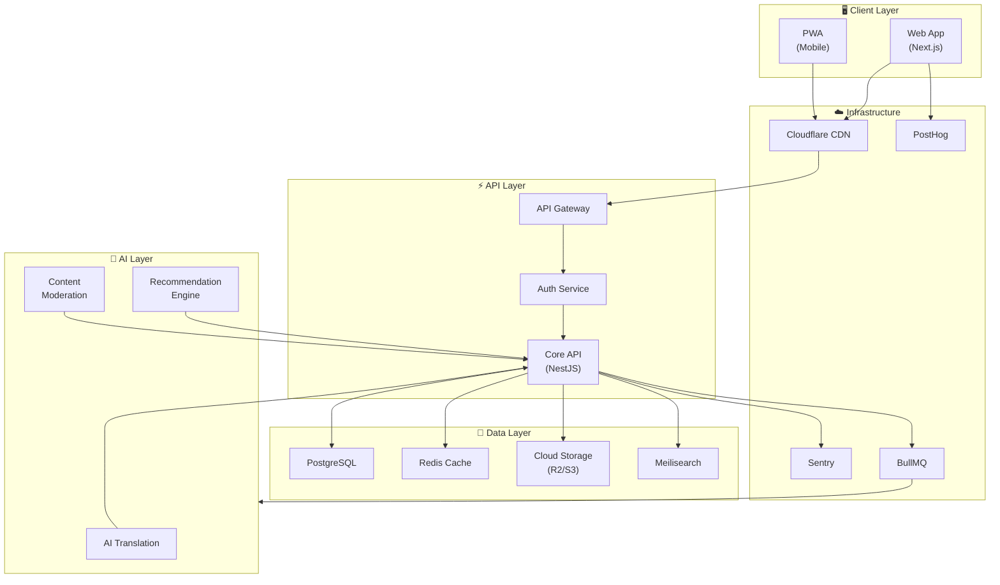
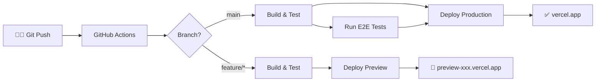
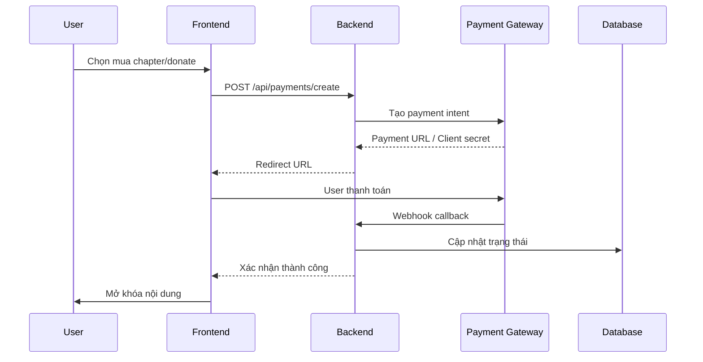

# 💻 Tech Stack – Comic Reading Platform

> Tài liệu mô tả chi tiết các công nghệ được sử dụng trong dự án **Nền tảng Đọc Truyện Tranh Online**.
> Cập nhật lần cuối: 2026-02-10

---

## 📐 Kiến trúc Tổng quan



---

## 🎨 Frontend

| Công nghệ | Phiên bản | Mô tả | Lý do chọn |
|-----------|-----------|-------|-------------|
| **Next.js** | 14+ (App Router) | React meta-framework | SSR/SSG cho SEO tốt, App Router cho nested layouts, streaming |
| **TypeScript** | 5.x | Ngôn ngữ lập trình | Type safety, DX tốt, giảm bugs runtime |
| **Tailwind CSS** | 3.x | Utility-first CSS | Rapid UI development, bundle size nhỏ, dễ maintain |
| **shadcn/ui** | latest | Component library | Không phải dependency, copy-paste, dễ customize |
| **Zustand** | 4.x | State management | Lightweight, simple API, không boilerplate |
| **TanStack Query** | 5.x | Server state management | Caching, auto refetch, optimistic updates |
| **Framer Motion** | 11.x | Animation library | Declarative, performant, gesture support |
| **next-pwa** | latest | Progressive Web App | Offline support, installable, push notifications |

### Chi tiết Frontend

#### Cấu trúc thư mục (dự kiến)

```
src/
├── app/                    # Next.js App Router
│   ├── (auth)/             # Auth routes group
│   ├── (reader)/           # Reading interface
│   ├── (author)/           # Author dashboard
│   ├── (admin)/            # Admin panel
│   ├── api/                # API routes (BFF)
│   └── layout.tsx          # Root layout
├── components/
│   ├── ui/                 # shadcn components
│   ├── comic/              # Comic-specific components
│   ├── reader/             # Reader components
│   └── shared/             # Shared components
├── hooks/                  # Custom React hooks
├── lib/                    # Utility functions
├── stores/                 # Zustand stores
├── styles/                 # Global styles
└── types/                  # TypeScript types
```

#### Tính năng kỹ thuật nổi bật

- **Image Optimization**: Sử dụng `next/image` với format WebP/AVIF, lazy loading, blur placeholder
- **Infinite Scroll**: Virtualized list cho reading experience mượt mà (react-virtuoso)
- **Offline Reading**: Service Worker cache các chapter đã đọc
- **Responsive Design**: Mobile-first, breakpoints cho tablet và desktop
- **Dark/Light Mode**: CSS variables + prefers-color-scheme + user preference

---

## ⚙️ Backend

| Công nghệ | Phiên bản | Mô tả | Lý do chọn |
|-----------|-----------|-------|-------------|
| **Node.js** | 20 LTS | Runtime | Ecosystem lớn, async I/O phù hợp image-heavy app |
| **NestJS** | 10.x | Backend framework | Modular, scalable, TypeScript-first, DI pattern |
| **PostgreSQL** | 16.x | Primary database | ACID, JSONB support, full-text search, mature |
| **Redis** | 7.x | Caching & sessions | In-memory, pub/sub, rate limiting, session store |
| **Prisma** | 5.x | ORM | Type-safe queries, auto-generated types, migrations |
| **Meilisearch** | 1.x | Search engine | Typo-tolerant, fast, dễ setup hơn Elasticsearch |
| **BullMQ** | 5.x | Job queue | Redis-backed, reliable, scheduled jobs, retries |

### Chi tiết Backend

#### API Design

- **RESTful API** cho CRUD operations
- **WebSocket** (Socket.io) cho real-time features (comments, notifications)
- **GraphQL** (optional, Phase 2) cho complex queries trên trang Discovery

#### Database Schema (Core Tables)

```
┌──────────────┐     ┌──────────────┐     ┌──────────────┐
│    users      │     │    comics     │     │   chapters   │
├──────────────┤     ├──────────────┤     ├──────────────┤
│ id           │     │ id           │     │ id           │
│ email        │     │ title        │     │ comic_id  ──────┐
│ username     │     │ author_id ───────┐ │ number       │  │
│ role         │     │ description  │   │ │ title        │  │
│ avatar_url   │     │ cover_url    │   │ │ pages[]      │  │
│ created_at   │     │ status       │   │ │ is_premium   │  │
└──────────────┘     │ genres[]     │   │ │ created_at   │  │
       │             │ created_at   │   │ └──────────────┘  │
       │             └──────────────┘   │                    │
       │                    │           │                    │
       ▼                    ▼           ▼                    ▼
┌──────────────┐     ┌──────────────┐     ┌──────────────┐
│  bookmarks   │     │   comments   │     │   ratings    │
├──────────────┤     ├──────────────┤     ├──────────────┤
│ user_id      │     │ user_id      │     │ user_id      │
│ comic_id     │     │ chapter_id   │     │ comic_id     │
│ chapter_id   │     │ content      │     │ score        │
│ created_at   │     │ parent_id    │     │ review       │
└──────────────┘     │ created_at   │     │ created_at   │
                     └──────────────┘     └──────────────┘
```

#### Background Jobs (BullMQ)

| Job | Mô tả | Schedule |
|-----|-------|----------|
| `image-optimize` | Nén và convert ảnh sang WebP/AVIF | On upload |
| `ai-translate` | Dịch tự động chapter mới | On request |
| `recommendation-update` | Cập nhật đề xuất cho users | Daily |
| `content-moderation` | Kiểm duyệt nội dung mới upload | On upload |
| `email-notification` | Gửi email thông báo chapter mới | On publish |
| `analytics-aggregate` | Tổng hợp dữ liệu thống kê | Hourly |

---

## ☁️ Infrastructure & DevOps

| Công nghệ | Mô tả | Lý do chọn |
|-----------|-------|-------------|
| **Vercel** | Frontend hosting | Zero-config Next.js deploy, edge functions, preview URLs |
| **Railway** | Backend hosting | Dễ deploy Node.js, auto-scaling, managed DB |
| **Cloudflare** | CDN & DNS | Global CDN, DDoS protection, edge caching cho images |
| **Cloudflare R2** | Object storage | S3-compatible, zero egress fees, giá rẻ cho image hosting |
| **GitHub Actions** | CI/CD | Tích hợp sẵn GitHub, free cho public repos |
| **Docker** | Containerization | Consistent environment, dễ deploy và scale |

### Luồng CI/CD



### Monitoring & Observability

| Công cụ | Chức năng |
|---------|----------|
| **Sentry** | Error tracking, performance monitoring |
| **PostHog** | Product analytics, feature flags, session replay |
| **Uptime Robot** | Uptime monitoring, alerts |
| **Grafana + Loki** | Log aggregation, dashboards (Phase 2) |

---

## 🤖 AI & Machine Learning

| Công nghệ | Ứng dụng | Provider |
|-----------|----------|----------|
| **GPT-4o / Claude** | AI Translation Assistant | OpenAI / Anthropic |
| **GPT-4o Vision** | OCR text từ ảnh truyện | OpenAI |
| **Embedding Models** | Recommendation engine | OpenAI / Cohere |
| **Content Moderation API** | Kiểm duyệt ảnh & text | OpenAI / Google Cloud Vision |

### Chi tiết AI Pipeline

```
┌─────────────┐     ┌─────────────┐     ┌─────────────┐
│  Upload ảnh  │────▶│  OCR Text   │────▶│  AI Dịch    │
│  (chapter)   │     │  (Vision)   │     │  (GPT/Claude)│
└─────────────┘     └─────────────┘     └─────────────┘
       │                                        │
       ▼                                        ▼
┌─────────────┐                          ┌─────────────┐
│  Moderation  │                          │ Bilingual   │
│  Check       │                          │ Database    │
└─────────────┘                          └─────────────┘
```

---

## 🔐 Authentication & Security

| Công nghệ | Chức năng |
|-----------|----------|
| **NextAuth.js** (Auth.js) | OAuth providers (Google, Facebook, GitHub) |
| **JWT + Refresh Token** | Stateless authentication, token rotation |
| **bcrypt** | Password hashing |
| **Helmet.js** | HTTP security headers |
| **Rate Limiting** | Redis-based, chống brute force |
| **CORS** | Cross-origin resource sharing policy |
| **CSP** | Content Security Policy |

### Phân quyền (RBAC)

```
Reader (mặc định)
├── Đọc truyện miễn phí
├── Bookmark / Favorite
├── Comment / Rate
└── Follow tác giả

Author (upgrade)
├── Tất cả quyền Reader
├── Upload truyện / chapter
├── Quản lý truyện cá nhân
├── Xem analytics truyện
└── Nhận donations

Admin
├── Tất cả quyền Author
├── Quản lý users
├── Duyệt truyện mới
├── Content moderation
└── System settings
```

---

## 💳 Thanh toán

| Công nghệ | Thị trường | Hỗ trợ |
|-----------|-----------|--------|
| **Stripe** | Quốc tế | Credit/Debit cards, Apple Pay, Google Pay |
| **VNPay** | Việt Nam | ATM nội địa, QR Pay, ví điện tử |
| **MoMo** | Việt Nam | Ví MoMo, QR code |

### Luồng thanh toán



---

## 📦 Package Manager & Build Tools

| Công cụ | Mô tả |
|---------|-------|
| **pnpm** | Package manager (nhanh, disk-efficient) |
| **Turborepo** | Monorepo build system (nếu tách FE/BE) |
| **ESLint** | Linting |
| **Prettier** | Code formatting |
| **Husky + lint-staged** | Git hooks, pre-commit checks |
| **Vitest** | Unit testing |
| **Playwright** | E2E testing |

---

## 📊 Third-party Services

| Dịch vụ | Chức năng | Gói dự kiến |
|---------|----------|-------------|
| **Cloudflare** | CDN, DNS, R2 Storage | Free → Pro ($20/mo) |
| **Vercel** | Frontend hosting | Free → Pro ($20/mo) |
| **Railway** | Backend hosting | Starter → Pro (~$10-50/mo) |
| **Sentry** | Error tracking | Free tier (5K events/mo) |
| **PostHog** | Analytics | Free tier (1M events/mo) |
| **Resend** | Transactional email | Free tier (3K emails/mo) |
| **Uploadthing** | File uploads (backup) | Free tier (2GB) |

---

## 📈 Ước tính Chi phí Hạ tầng

### Phase MVP (0-5K users)

| Mục | Chi phí/tháng |
|-----|--------------|
| Vercel (Pro) | $20 |
| Railway (Backend + DB) | $10-30 |
| Cloudflare R2 (50GB) | ~$1 |
| Redis (Railway) | $5-10 |
| Domain | ~$1 |
| **Tổng** | **~$40-65/tháng** |

### Phase Growth (5K-50K users)

| Mục | Chi phí/tháng |
|-----|--------------|
| Vercel (Pro) | $20 |
| Railway (scaled) | $50-100 |
| Cloudflare R2 (500GB) | ~$8 |
| Managed PostgreSQL | $30-50 |
| Redis (managed) | $15-30 |
| AI APIs | $100-300 |
| **Tổng** | **~$225-510/tháng** |

---

## 🔗 Tài liệu Tham khảo

| Công nghệ | Link |
|-----------|------|
| Next.js | https://nextjs.org/docs |
| NestJS | https://docs.nestjs.com |
| Prisma | https://www.prisma.io/docs |
| Tailwind CSS | https://tailwindcss.com/docs |
| shadcn/ui | https://ui.shadcn.com |
| TanStack Query | https://tanstack.com/query |
| Zustand | https://zustand-demo.pmnd.rs |
| Meilisearch | https://www.meilisearch.com/docs |
| BullMQ | https://docs.bullmq.io |
| Stripe | https://stripe.com/docs |
| Cloudflare R2 | https://developers.cloudflare.com/r2 |
| Sentry | https://docs.sentry.io |
| PostHog | https://posthog.com/docs |

---

> [!NOTE]
> Tài liệu này sẽ được cập nhật liên tục khi dự án phát triển. Các lựa chọn công nghệ có thể thay đổi dựa trên nhu cầu thực tế và feedback từ quá trình phát triển.
