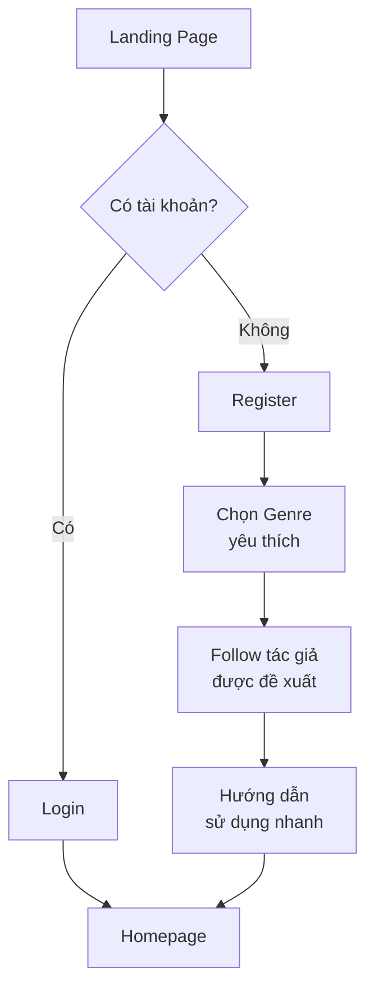
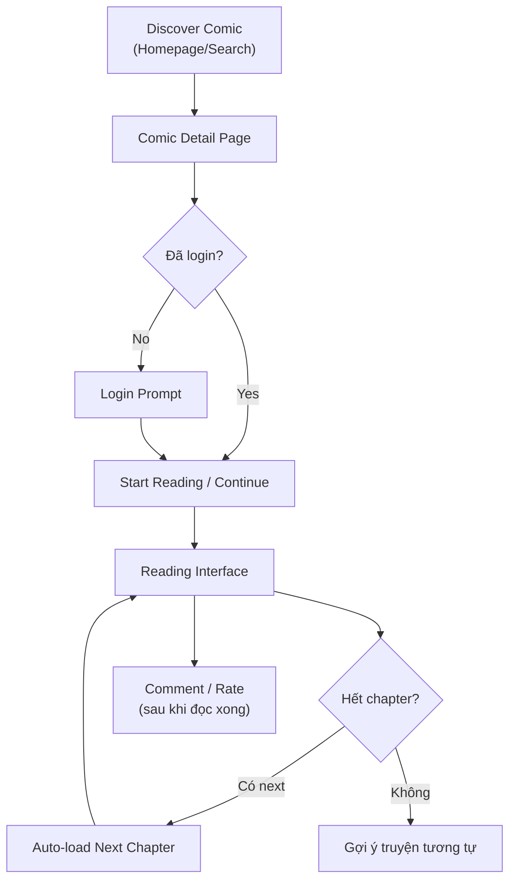
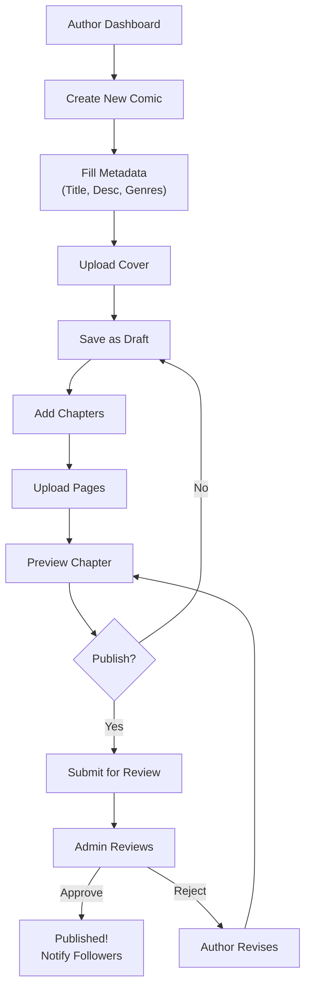

# 🎨 UI/UX Guidelines – Comic Reading Platform

> **Phiên bản**: 1.0  
> **Design System**: Custom (Tailwind CSS + shadcn/ui)  
> **Cập nhật**: 2026-02-10

---

## 1. Design Principles

### 1.1. Nguyên tắc cốt lõi

| # | Nguyên tắc | Mô tả |
|---|-----------|-------|
| 1 | **Content First** | Truyện tranh là nhân vật chính — UI phải tôn trọng nội dung, không lấn át |
| 2 | **Mobile First** | 70%+ users đọc trên mobile — thiết kế cho mobile trước |
| 3 | **Accessibility** | WCAG 2.1 AA — mọi người đều có thể sử dụng |
| 4 | **Performance** | UI phải nhanh, mọi interaction < 100ms response |
| 5 | **Consistency** | Sử dụng design tokens nhất quán trên toàn ứng dụng |

---

## 2. Design Tokens

### 2.1. Color Palette

```
┌───────────────────────────────────────────────────┐
│                COLOR PALETTE                       │
├───────────────────────────────────────────────────┤
│                                                    │
│  Primary (Brand)                                   │
│  ├── 50:  #EEF2FF   (lightest)                    │
│  ├── 100: #E0E7FF                                  │
│  ├── 200: #C7D2FE                                  │
│  ├── 300: #A5B4FC                                  │
│  ├── 400: #818CF8                                  │
│  ├── 500: #6366F1   ← Primary                     │
│  ├── 600: #4F46E5                                  │
│  ├── 700: #4338CA                                  │
│  ├── 800: #3730A3                                  │
│  └── 900: #312E81   (darkest)                     │
│                                                    │
│  Accent (Highlight)                                │
│  └── #F59E0B (Amber) — CTA, notifications         │
│                                                    │
│  Semantic                                          │
│  ├── Success: #10B981 (Emerald)                   │
│  ├── Warning: #F59E0B (Amber)                     │
│  ├── Error:   #EF4444 (Red)                       │
│  └── Info:    #3B82F6 (Blue)                      │
│                                                    │
│  Neutral (Gray)                                    │
│  ├── 50:  #F9FAFB                                 │
│  ├── 100: #F3F4F6                                 │
│  ├── 200: #E5E7EB                                 │
│  ├── 300: #D1D5DB                                 │
│  ├── 400: #9CA3AF                                 │
│  ├── 500: #6B7280                                 │
│  ├── 600: #4B5563                                 │
│  ├── 700: #374151                                 │
│  ├── 800: #1F2937                                 │
│  └── 900: #111827                                 │
│                                                    │
└───────────────────────────────────────────────────┘
```

### 2.2. Typography

| Element | Font | Size | Weight | Line Height |
|---------|------|------|--------|-------------|
| H1 | Inter | 36px / 2.25rem | Bold (700) | 1.2 |
| H2 | Inter | 30px / 1.875rem | Semibold (600) | 1.3 |
| H3 | Inter | 24px / 1.5rem | Semibold (600) | 1.3 |
| H4 | Inter | 20px / 1.25rem | Medium (500) | 1.4 |
| Body | Inter | 16px / 1rem | Regular (400) | 1.6 |
| Body Small | Inter | 14px / 0.875rem | Regular (400) | 1.5 |
| Caption | Inter | 12px / 0.75rem | Regular (400) | 1.5 |
| Button | Inter | 14px-16px | Medium (500) | 1.0 |

### 2.3. Spacing System

Base unit: **4px**

| Token | Value | Usage |
|-------|-------|-------|
| `space-1` | 4px | Inline spacing |
| `space-2` | 8px | Tight spacing |
| `space-3` | 12px | Component internal |
| `space-4` | 16px | Standard gap |
| `space-5` | 20px | Section spacing |
| `space-6` | 24px | Card padding |
| `space-8` | 32px | Section gap |
| `space-10` | 40px | Large spacing |
| `space-12` | 48px | Page section gap |
| `space-16` | 64px | Major section gap |

### 2.4. Breakpoints

| Name | Width | Target |
|------|-------|--------|
| `xs` | 0-479px | Small phone |
| `sm` | 480-639px | Phone |
| `md` | 640-767px | Large phone / Small tablet |
| `lg` | 768-1023px | Tablet |
| `xl` | 1024-1279px | Small desktop |
| `2xl` | 1280px+ | Desktop |

### 2.5. Border Radius

| Token | Value | Usage |
|-------|-------|-------|
| `rounded-sm` | 4px | Buttons nhỏ, input |
| `rounded` | 8px | Cards, containers |
| `rounded-lg` | 12px | Modals, dialogs |
| `rounded-xl` | 16px | Feature cards |
| `rounded-full` | 9999px | Avatars, badges |

### 2.6. Shadows

| Token | Value | Usage |
|-------|-------|-------|
| `shadow-sm` | `0 1px 2px rgba(0,0,0,0.05)` | Subtle elevation |
| `shadow` | `0 1px 3px rgba(0,0,0,0.1)` | Cards |
| `shadow-md` | `0 4px 6px rgba(0,0,0,0.1)` | Dropdowns |
| `shadow-lg` | `0 10px 15px rgba(0,0,0,0.1)` | Modals |
| `shadow-xl` | `0 20px 25px rgba(0,0,0,0.1)` | Floating elements |

---

## 3. Dark Mode / Light Mode

### 3.1. Theme Variables

```css
/* Light Mode */
:root {
  --bg-primary: #FFFFFF;
  --bg-secondary: #F9FAFB;
  --bg-tertiary: #F3F4F6;
  --text-primary: #111827;
  --text-secondary: #4B5563;
  --text-muted: #9CA3AF;
  --border: #E5E7EB;
  --reader-bg: #FFFFFF;
}

/* Dark Mode */
[data-theme="dark"] {
  --bg-primary: #111827;
  --bg-secondary: #1F2937;
  --bg-tertiary: #374151;
  --text-primary: #F9FAFB;
  --text-secondary: #D1D5DB;
  --text-muted: #6B7280;
  --border: #374151;
  --reader-bg: #000000;
}
```

### 3.2. Reader-specific Themes

| Theme | Background | Text | Mục đích |
|-------|-----------|------|----------|
| **Default** | White/Dark | Auto | Chế độ mặc định |
| **Sepia** | #F4ECD8 | #5B4636 | Giảm mỏi mắt |
| **Night** | #000000 | N/A | Đọc ban đêm, AMOLED |

---

## 4. Component Specifications

### 4.1. Comic Card

```
┌──────────────────────┐
│  ┌──────────────────┐ │  Size: 180 x 280 (cover ratio ~2:3)
│  │                  │ │
│  │   COVER IMAGE    │ │  ← blurhash placeholder
│  │   (lazy loaded)  │ │
│  │                  │ │  ← tag badge (NEW, HOT, ...)
│  │                  │ │
│  └──────────────────┘ │
│  Title (max 2 lines)  │  ← truncate with ellipsis
│  ★ 4.5  •  Ch.45      │  ← rating + chapter count
│  Author Name           │  ← link to author profile
└──────────────────────┘
```

**Hover State**: Scale 1.05 + shadow-lg + show quick-action buttons

### 4.2. Comic Grid Layout

| Screen | Columns | Gap |
|--------|---------|-----|
| Mobile (< 640px) | 3 | 8px |
| Tablet (640-1023px) | 4-5 | 12px |
| Desktop (1024px+) | 5-7 | 16px |

### 4.3. Reading Interface

#### Vertical Scroll Mode (Webtoon)
```
┌────────────────────────────┐
│  ← ☰  Ch.42: Tên Chapter  │  ← Sticky header (auto-hide on scroll down)
├────────────────────────────┤
│                             │
│      [Page 1 Image]         │  ← Full width, maintain aspect ratio
│                             │
│      [Page 2 Image]         │  ← Lazy loaded, blurhash placeholder
│                             │
│      [Page 3 Image]         │
│                             │
│          ...                │  ← Virtual list (react-virtuoso)
│                             │
├────────────────────────────┤
│  ← Prev   Progress   Next → │  ← Bottom navigation bar
└────────────────────────────┘
```

#### Page-by-Page Mode (Manga)
```
┌────────────────────────────┐
│  ← ☰  Ch.42: Tên Chapter  │
├────────────────────────────┤
│                             │
│                             │
│      [Single Page Image]    │  ← Fit to screen
│      (tap left/right to     │
│       navigate)             │
│                             │
│                             │
├────────────────────────────┤
│  ◀ 15 / 25 ▶               │  ← Page indicator + slider
└────────────────────────────┘
```

### 4.4. Comment Component

```
┌──────────────────────────────────────┐
│  🔵 Username  •  2 giờ trước         │
│                                       │
│  Nội dung comment ở đây...            │
│                                       │
│  ❤️ 15   💬 Reply   ⚑ Report         │
│                                       │
│    ┌──────────────────────────────┐   │  ← Reply (indented)
│    │  🔵 Another User  •  1h ago  │   │
│    │  Reply content...            │   │
│    │  ❤️ 3   💬 Reply             │   │
│    └──────────────────────────────┘   │
└──────────────────────────────────────┘
```

---

## 5. Page Layouts

### 5.1. Homepage Layout

```
┌─────────────────────────────────────────────┐
│  HEADER: Logo  |  Search  |  🔔  |  Avatar  │
├─────────────────────────────────────────────┤
│                                              │
│  ┌──── HERO BANNER / CAROUSEL ────────────┐ │
│  │  Featured Comics (auto-rotate 5s)       │ │
│  └────────────────────────────────────────┘ │
│                                              │
│  📈 Trending Now                     See All │
│  ┌────┐ ┌────┐ ┌────┐ ┌────┐ ┌────┐       │
│  │    │ │    │ │    │ │    │ │    │  ← scroll│
│  └────┘ └────┘ └────┘ └────┘ └────┘       │
│                                              │
│  🆕 Latest Updates                   See All │
│  ┌────┐ ┌────┐ ┌────┐ ┌────┐ ┌────┐       │
│  │    │ │    │ │    │ │    │ │    │        │
│  └────┘ └────┘ └────┘ └────┘ └────┘       │
│                                              │
│  ⭐ Top Rated                        See All │
│  ┌────┐ ┌────┐ ┌────┐ ┌────┐ ┌────┐       │
│  │    │ │    │ │    │ │    │ │    │        │
│  └────┘ └────┘ └────┘ └────┘ └────┘       │
│                                              │
│  📚 Browse by Genre                          │
│  ┌───────┐ ┌───────┐ ┌───────┐ ┌───────┐  │
│  │Action │ │Comedy │ │Drama  │ │Fantasy│  │
│  └───────┘ └───────┘ └───────┘ └───────┘  │
│                                              │
├─────────────────────────────────────────────┤
│  FOOTER: About | Terms | Contact | Social   │
└─────────────────────────────────────────────┘
```

### 5.2. Comic Detail Page

```
┌─────────────────────────────────────────────┐
│  HEADER                                      │
├─────────────────────────────────────────────┤
│  ┌────────── BANNER IMAGE ──────────────┐   │
│  │                                       │   │
│  │  ┌────┐                               │   │
│  │  │COVER│  Title                       │   │
│  │  │    │  Author  •  Status: Ongoing   │   │
│  │  │    │  ★ 4.5 (230 reviews)          │   │
│  │  └────┘  ❤️ 1.5K  •  👁 12.5K views  │   │
│  │          [Bookmark] [Start Reading]   │   │
│  └───────────────────────────────────────┘   │
│                                              │
│  Genres: [Action] [Fantasy] [Adventure]      │
│                                              │
│  📖 Synopsis                                 │
│  Mô tả truyện ở đây...                      │
│  [Show more]                                 │
│                                              │
│  ┌── Tabs ──────────────────────────────┐   │
│  │ [Chapters] | [Comments] | [Reviews]  │   │
│  ├──────────────────────────────────────┤   │
│  │  Ch.45  Tên chapter      2h ago  NEW  │   │
│  │  Ch.44  Tên chapter      1d ago       │   │
│  │  Ch.43  Tên chapter      3d ago  ✓    │   │
│  │  ...                                  │   │
│  └──────────────────────────────────────┘   │
│                                              │
└─────────────────────────────────────────────┘
```

---

## 6. User Flows

### 6.1. Onboarding Flow



### 6.2. Reading Flow



### 6.3. Author Publishing Flow



---

## 7. Animations & Micro-interactions

### 7.1. Transitions

| Element | Animation | Duration | Easing |
|---------|-----------|----------|--------|
| Page transition | Fade | 200ms | ease-out |
| Modal open | Scale + Fade | 250ms | ease-out |
| Modal close | Scale + Fade | 200ms | ease-in |
| Dropdown | Slide down + Fade | 150ms | ease-out |
| Toast notification | Slide in from right | 300ms | spring |
| Comic card hover | Scale(1.05) | 200ms | ease-out |
| Image lazy load | Fade in | 300ms | ease-in |
| Skeleton loading | Pulse | 1.5s | infinite |

### 7.2. Loading States

| State | UI |
|-------|-----|
| **Initial page load** | Skeleton screens (shimmer effect) |
| **Image loading** | Blurhash placeholder → fade in |
| **Data fetching** | Spinner (nếu < 3s), skeleton (nếu > 3s) |
| **Button action** | Spinner in button, disabled state |
| **Infinite scroll** | Small spinner at bottom |

### 7.3. Feedback

| Action | Feedback |
|--------|----------|
| Bookmark toggled | Heart animation + toast |
| Comment posted | Slide in animation |
| Rating submitted | Star fill animation |
| Follow/Unfollow | Button state change + count update |
| Error occurred | Red toast with message |

---

## 8. Responsive Design Patterns

### 8.1. Navigation

| Screen | Navigation Style |
|--------|-----------------|
| Mobile | Bottom tab bar (Home, Search, Library, Profile) |
| Tablet | Side navigation (collapsible) |
| Desktop | Top header navigation |

### 8.2. Content Adaptation

| Component | Mobile | Tablet | Desktop |
|-----------|--------|--------|---------|
| Comic grid | 3 cols | 4-5 cols | 5-7 cols |
| Comic detail | Stack layout | Side-by-side | Side-by-side wide |
| Reader | Full screen | Full screen | Centered max-width |
| Comments | Full width | Max 640px centered | Sidebar |

---

## 9. Accessibility Guidelines

### 9.1. WCAG 2.1 AA Requirements

| Criterion | Yêu cầu |
|-----------|---------|
| **Color Contrast** | Text/background ratio ≥ 4.5:1 (normal), ≥ 3:1 (large) |
| **Focus Indicators** | Visible focus outline trên mọi interactive element |
| **Keyboard Navigation** | Mọi chức năng hoạt động được bằng keyboard |
| **Alt Text** | Mọi ảnh non-decorative đều có alt text |
| **Screen Reader** | Semantic HTML, ARIA labels khi cần |
| **Touch Target** | Min 44x44px cho touch targets |
| **Motion** | Tôn trọng `prefers-reduced-motion` |

### 9.2. Reader Accessibility

| Feature | Mô tả |
|---------|-------|
| Font size adjustment | Cho text-based content |
| Reading direction | LTR (default), RTL (Arabic) |
| Keyboard shortcuts | Arrow keys, Space, Escape |
| High contrast mode | Tăng contrast cho người nhìn yếu |
